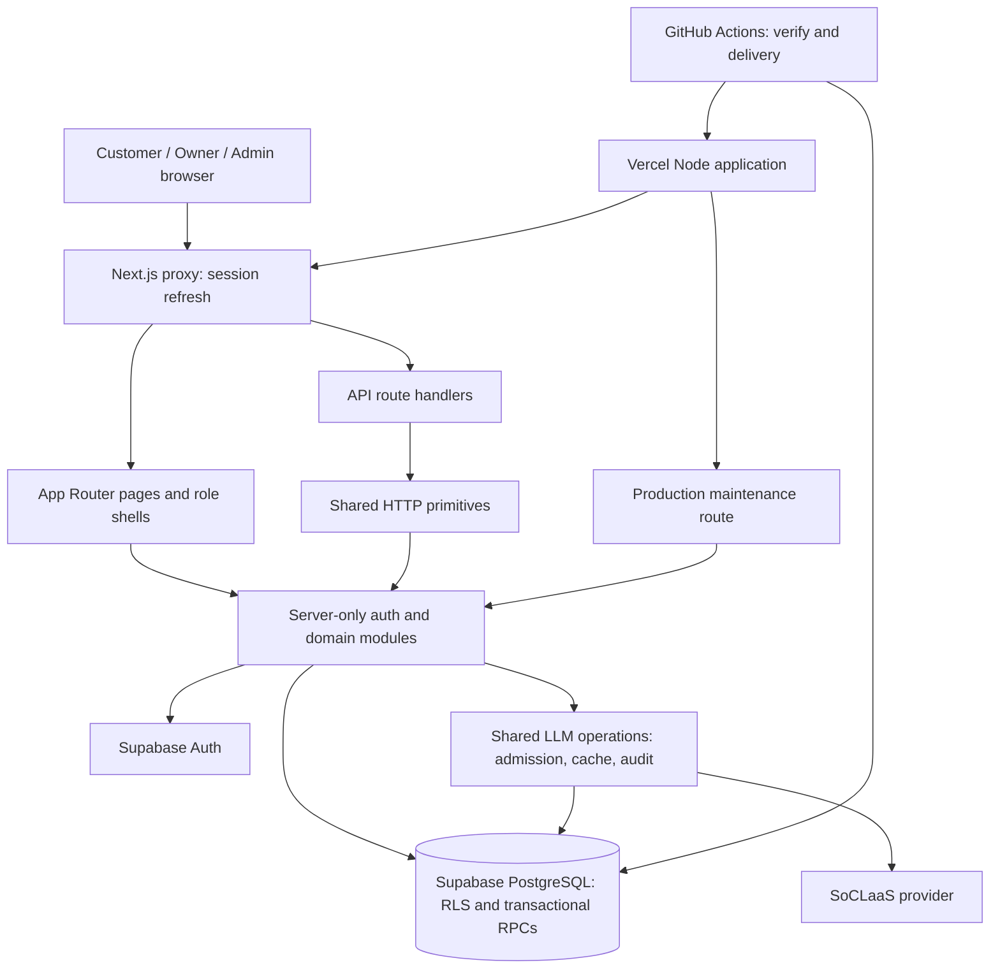
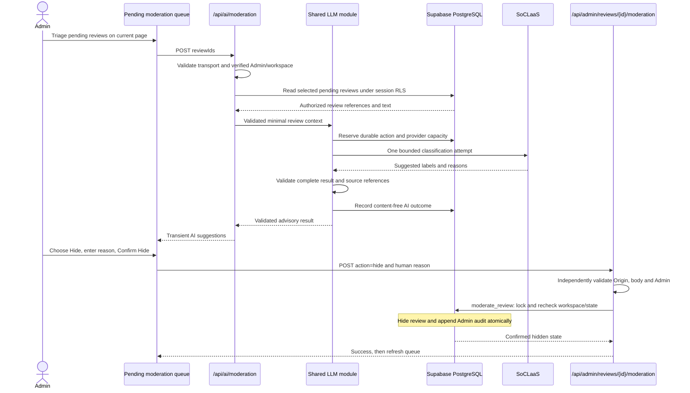
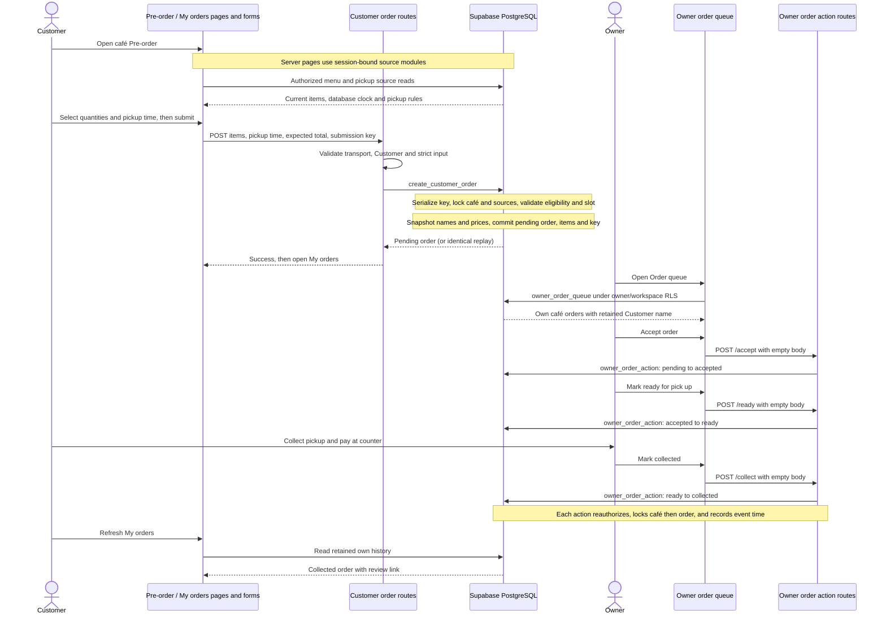

# Homebrew Developer Guide

This guide records Homebrew's design, development process and reuse for CS3227 MP3.

## Contents

- [Acknowledgements](#acknowledgements)
- [Setting up, getting started](#setting-up-getting-started)
  - [Local demonstration data](#local-demonstration-data)
- [Development workflow](#development-workflow)
- [Architectural design](#architectural-design)
  - [Design decisions](#design-decisions)
- [Shared UI conventions](#shared-ui-conventions)
- [Data model and database schema](#data-model-and-database-schema)
  - [Manual moderation and Admin audit](#manual-moderation-and-admin-audit)
  - [Customer catalogue and café details](#customer-catalogue-and-café-details)
  - [Customer pickup orders and retained history](#customer-pickup-orders-and-retained-history)
  - [Customer collected-order reviews](#customer-collected-order-reviews)
  - [Café applications and suspension](#café-applications-and-suspension)
  - [Owner order queue](#owner-order-queue)
  - [Owner menu](#owner-menu)
  - [Owner prep sheet](#owner-prep-sheet)
  - [Owner café application and settings](#owner-café-application-and-settings)
- [Authentication and authorization](#authentication-and-authorization)
  - [Demo-kit creation](#demo-kit-creation)
  - [Daily maintenance](#daily-maintenance)
- [Shared accounts and role navigation](#shared-accounts-and-role-navigation)
- [AI features and the shared LLM module](#ai-features-and-the-shared-llm-module)
  - [Brew Finder](#brew-finder)
  - [Moderation Assistant](#moderation-assistant)
  - [Owner sales and Prep Advisor](#owner-sales-and-prep-advisor)
- [Security](#security)
- [How to test](#how-to-test)
- [Deployment and environments](#deployment-and-environments)
- [Planned enhancements](#planned-enhancements)
- [Design considerations](#design-considerations)
- [Appendix: Requirements](#appendix-requirements)
- [Known limitations](#known-limitations)

## Acknowledgements

Homebrew started from the Next.js `create-next-app` scaffold (commit `c977dbe`).

### Reuse from MP2

Source: [CS3227 MP2](https://github.com/CS3227-2610-MP2-Gymmie/CS3227-2610-MP2).

- **As is:** copied with at most name or path changes.
- **Adapted:** structure kept, content edited for this project.
- **Rewritten:** only the idea kept.

Five files are reused: two Adapted, two Rewritten and one As is.

| MP2 file | MP3 file | Level | What changed |
| --- | --- | --- | --- |
| `.agents/skills/implement-issue/assets/report-template.md` | `workflow/templates/handoff.md` | Adapted | Kept report metadata, criterion evidence, review responses and reflection. Generalised fields for all agents; added status, checks, changed files, gaps and suspicious content. Removed MP2 scores, checklists and the embedded independent-review section; responses now reference separate reviewer reports. |
| `.agents/skills/session-log/SKILL.md` | `.agents/skills/session-log/SKILL.md` | As is | Copied byte for byte; no changes. |
| `evals/implement-issue/review.sh` | `.agents/skills/sdd-review/scripts/review.sh` | Adapted | Kept the fresh read-only Codex process and merge-base/working-tree scope. Uses the configured model and effort; replaced scores and in-place appending with a spec-based, separately numbered reviewer handoff. Added verification evidence, a three-round limit, secret exclusions, input-change checks and overwrite protection. The agent wrapper and skill metadata are new. |
| `.agents/skills/issue-extractor/SKILL.md` | `workflow/scripts/create-issues.ts` | Rewritten | Kept the ideas of never creating issues as part of an agent run, exact-title idempotency, resolving issue numbers at runtime and checking milestones. Replaced the generated per-section shell script with one TypeScript CLI over every PLAN.md task. It previews by default; `--apply` refuses to run unless the spec check passes, PLAN.md matches master and a human confirms at a terminal. Adds role labels, one milestone per plan section and optional PLAN.md Issue links. |
| `.agents/skills/update-user-guide/SKILL.md` | `workflow/agents/docs.md`, `.agents/skills/sdd-docs/SKILL.md` | Rewritten | Kept the ideas of documenting only implemented behaviour, updating sections in place without stale text, matching on-screen names and keeping the contents list in sync. Replaced the JavaFX-specific steps with a docs agent covering the User and Developer Guides, claim-to-evidence reporting, spec/code discrepancy handling and a ban on editing reflections. |

<!-- Add all later reuse to this table and update the totals above. -->

The shared LLM implementation reuses the three literal system messages from
[INTEGRATION-SPEC](../workflow/specs/INTEGRATION-SPEC.md#exact-feature-prompts-and-schemas)
as is in `src/server/llm/prompts.ts`; the acceptance fixture independently copies
the same contract into `tests/integration/llm/prompts.json`. This is internal
contract reuse, outside the five-file MP2 totals above.

The Shared account implementation reuses existing session/workspace guards and
Supabase SSR clients, with new account handlers and UI rather than copied
external application code. Installed Next.js request-time authentication guidance
informed its `connection()`/Suspense boundaries (idea reuse). Account field,
message and destination constants implement the internal Shared contracts;
these additions do not change the MP2 reuse totals.

Manual moderation reuses the existing session/workspace guards, session-bound
Supabase client, bounded JSON reader and trusted-origin helper (internal code
reuse). Its request-time Suspense pattern follows the installed Next.js guidance
(idea reuse); quick-pick literals implement the internal ADM-04 contract as is.
No external snippet or workflow file was added by this pair; MP2 totals remain unchanged.
Moderation Assistant reuses the existing review RLS policy, shared HTTP primitives,
LLM operation/admission/audit composition and ordinary per-review confirmation
(internal code reuse). Its client boundary follows installed Next.js guidance
(idea reuse); no external snippet, dependency or workflow was added, so the MP2
totals remain unchanged.

The Customer catalogue reuses the existing session-bound Supabase client,
account access resolver and streamed role shell (internal code reuse). Its
request-time rendering and original-query proxy integration use installed
Next.js guidance as idea reuse; no external snippet or new workflow file was
added. The five-file MP2 reuse totals remain unchanged.
Brew Finder reuses that catalogue's filter/rating comparator and merged opening
intervals, the authorized café detail endpoint, and the shared fixed
LLM/admission/cache/audit lifecycle (internal code reuse). Its client form and
route handler follow the installed Next.js guidance (idea reuse). No external
snippet, dependency or workflow file was added; MP2 totals remain unchanged.
Café eligibility reuses those same session/RLS, transport, audit and Suspense
patterns (internal code/idea reuse), including the existing moderation Admin
lookup and audit ledger. No external snippet, dependency or workflow was added;
the MP2 reuse totals are unchanged.

Demo kits reuse the existing private usage-counter store/locking pattern,
workspace RLS, ordinary Admin RPCs and shared HTTP primitives (internal code
reuse). Installed Next.js “Preserving UI state” guidance informed the
layout-effect cleanup for Activity boundaries (idea reuse); the implementation
adds request cancellation and synchronous pagehide clearing for credentials.
No external application snippet or workflow file was copied; MP2 reuse totals
remain five files (two Adapted, two Rewritten, one As is).

Daily maintenance reuses T-16's `createAiState().cleanup()` repository, shared
private JSON responses and Supabase Auth Admin creation (internal code reuse).
It extends the existing production deployment workflow and follows the installed
Next.js Route Handler guidance. No external snippet, new dependency or new
workflow file was added; MP2 reuse totals are unchanged.

### AI assistance

The team used OpenAI Codex and Anthropic Claude Code as coding assistants, as
the brief allows. They ran as the specialised agents described under
[Development workflow](#development-workflow) (spec, testing, implementation,
reviewer, security-reviewer and docs) and as the coordinating session. Their
commits carry an `Agent:` trailer, and Claude Code commits also carry a
`Co-Authored-By` trailer. Each agent's work is recorded in its numbered handoff
under `workflow/handoffs/`, and the prompts and interactions are summarised in
`logs/`. Humans approved the specifications, reviewed every diff, committed,
opened and merged the pull requests, and approved production deployments. No
spec-driven development toolkit was used; the workflow files are the team's own.

The runtime AI features call the SoC LLM service (SoCLaaS) through
`src/server/llm/`, following its
[documentation](https://dochub.comp.nus.edu.sg/cf/guides/soclaas/start).

### Third-party software and documentation

Homebrew depends on these libraries and tools; the exact versions are in
`package.json` and `bun.lock`. No third-party application code was copied into
the repository beyond the MP2 files listed above.

| Library or tool | Used for |
| --- | --- |
| [Next.js](https://nextjs.org/) and [React](https://react.dev/) | App Router pages, route handlers and UI. The Next.js guides installed in `node_modules/next/dist/docs/` informed several patterns, as noted in the reuse paragraphs above. |
| [Supabase](https://supabase.com/) (PostgreSQL, Auth, `@supabase/ssr`, CLI) | Database, row-level security, authentication and local development stack. |
| [Zod](https://zod.dev/) | Validation of untrusted inputs and AI outputs. |
| [Tailwind CSS](https://tailwindcss.com/) | Styling. |
| [Vitest](https://vitest.dev/) and [Playwright](https://playwright.dev/) | Unit, integration and browser tests. |
| [TypeScript](https://www.typescriptlang.org/), [ESLint](https://eslint.org/) and [Bun](https://bun.sh/) | Language, linting and package management. |
| [Vercel](https://vercel.com/) and GitHub Actions | Hosting and the CI and deployment workflows. |
| [GitHub Pages](https://pages.github.com/) with the [Cayman theme](https://github.com/pages-themes/cayman) | The product website in `docs/`. |

## Setting up, getting started

Use Node.js 24, Bun 1.4.3 and a running Docker engine with the `docker` command
available. Install pinned dependencies from the repository root:

```bash
bun install --frozen-lockfile
bun run db:start
bun run db:reset
bun run db:check
```

The repository pins Supabase CLI 2.121.0 as a development dependency.
`scripts/database.ts` runs the installed CLI from the repository root and accepts
only these three actions, without extra arguments or target URLs:

| Command | Effect |
| --- | --- |
| `bun run db:start` | Starts the Docker-backed local Supabase project `homebrew`; succeeds when it is already running. |
| `bun run db:reset` | Recreates the local database and replays migrations with `--local --no-seed`. This discards local data. |
| `bun run db:check` | Inspects the local PostgreSQL catalogue and exits nonzero if any application table lacks RLS, listing the schema/table names. |

`supabase/config.toml` selects PostgreSQL 17, API port 54321 and database port
54322. The Data API is enabled for `public`, with automatic exposure of new
tables disabled. Auth is enabled locally; Studio, storage, realtime, local SMTP,
edge runtime, analytics and the pooler are disabled. Automatic seed execution is
disabled; migrations create the main workspace and install the Auth provisioning
trigger. These commands do not create demonstration accounts or domain data.

The wrapper captures CLI status output and omits generated credentials on success.
Failures show a bounded, filtered subset of diagnostics; this filter is heuristic.
The catalogue command uses `docker exec` against `supabase_db_homebrew`, with no
connection URL or credential lookup. These commands require local Docker access
and have no hosted target option.

Before starting the app, supply `APP_ENV=local`, `AI_PROVIDER=disabled`,
`NEXT_PUBLIC_SUPABASE_URL` for the local stack and its
`NEXT_PUBLIC_SUPABASE_PUBLISHABLE_KEY` through the development environment.
The request proxy validates this configuration for browser pages; missing or
invalid values fail with `Invalid application configuration.` See the
[configuration contract](../workflow/specs/TECHNICAL-SPEC.md#configuration-names).
Account registration also needs server-only `SUPABASE_SECRET_KEY`. Account POSTs
require an exact canonical origin: set server-only `APP_ORIGIN` to the browser
origin (scheme, host and optional port, without a trailing slash/path). Otherwise
`VERCEL_URL` supplies an HTTPS origin, or local/CI defaults to
`http://127.0.0.1:${PORT}` with port 3000 when `PORT` is absent. For local use,
either open <http://127.0.0.1:3000> or explicitly configure `APP_ORIGIN` for
<http://localhost:3000>. Request Host/forwarding headers do not establish trust.
Manual moderation also requires server-only `AI_MODERATION_REVIEWS_PER_CALL`
in local development, even with `AI_PROVIDER=disabled`. Set it to a digit string
representing an integer from 1 through 20 (leading zeros are accepted). The
server-only Zod reader in `src/server/reviews/queue-config.ts` rejects missing,
malformed or out-of-range values; the queue fails closed with “Unable to load
reviews.” rather than choosing a default. Correct the setting and use **Try
again** after restarting the app with the corrected environment. This setting controls manual queue page size; it does not enable AI.

Run `bun run dev`; `/` resolves to Sign in or the verified role home.

### Local demonstration data

After local startup and migration replay, explicitly populate the demonstration
dataset from the repository root:

```bash
bun --conditions=react-server -e 'const { seedLocalDemonstration } = await import("./src/server/seeds/local.ts"); const result = await seedLocalDemonstration({ environment: "local", supabaseUrl: "http://127.0.0.1:54321", provider: "disabled" }); console.log(result.createdAccounts.length);'
```

This prints only the number of newly created accounts. The server-only entry
uses Docker/psql against the configured local container; it never follows a
linked project, supplied database URL or HTTP target. It accepts only local/CI,
fake/disabled AI and a plain loopback HTTP URL on the configured API port.
Hosted environments and other targets fail before database execution.

`supabase/local-demonstration.sql` is separate from migrations. One transaction
with an advisory lock creates five main-workspace accounts (two Customers, two
owners and one Admin), two approved, non-suspended cafés with menus/hours, and
two past orders with purchased items. Stable domain identities and timestamps
make replay reproducible. Inserts preserve existing data; mismatched account
identities cause failure. Passwords are random on first creation. The return
value contains credentials only for newly created accounts; replay neither
retrieves nor rotates existing passwords. Keep that return value out of logs,
guides and artifacts. The example intentionally omits credentials.

`db:reset` removes local data; re-run this explicit seed afterward if needed.
The demonstration dataset supplies no demo-kit provisioning, order fulfilment
lifecycle or sales interpretation. Hosted delivery applies migrations without
this seed; it does not ship demonstration passwords.

## Development workflow

The workflow files below implement the team's agreed development process.
Agents and `review.sh` use their configured model and effort.

### The per-feature loop, in order

1. A spec is approved when its PR is merged after unresolved points are
   resolved. Testing and implementation work only from specs on master.
2. The spec agent updates `workflow/PLAN.md` with testing/implementation pairs.
   Each pair covers up to three related stories of one role; an owner may ask
   for one story per pair. Every update reports the total pair count and
   reconciles task statuses from handoff evidence.
3. Each task becomes its own issue. The pair shares one branch, handoff folder
   and PR, named after the testing issue. The PR closes both issues.
4. The testing agent reads approved stories, linked contracts and only its own
   task, then writes failing acceptance tests. A human checks the tests against
   the criteria and commits them before implementation starts.
5. Implementation works on its task until the affected tests pass, then runs
   `bun run verify` on the final code.
   It may add supplementary unit tests under `tests/unit/` for internal code it
   introduces, with no criterion IDs in titles. It never edits, skips or weakens
   the testing agent's tests, fixtures or test configuration; suspected errors
   go back to testing. The human commits implementation work at the end of the
   pair, not after each round.
6. The reviewer assesses the uncommitted or committed code and the
   implementation handoff using a separate read-only CLI worker, after rerunning
   `bun run verify`. The caller coordinates fixes and at most three review
   rounds per pair. The latest completed/pass report supplies completion evidence
   for close-out.
7. The security reviewer runs once per pair, right after the first review round
   on the same code, and applies baseline checks plus task SEC criteria and
   relevant AI-SECURITY-SPEC evaluation cases when present. It relies on that
   review's verify result. It writes
   its own next `NN-security-reviewer.md` in the pair's folder and edits nothing else.
   Its P0/P1 findings join the review's findings in one implementation fix
   round, followed by independent review; required acceptance-test changes go
   to testing. A later review must pass again.
8. The docs agent documents implemented behaviour with evidence and runs the
   spec check. Close-out checks the latest review and reports. With the latest
   review completed/pass, the pair session sets both tasks to `done`, then runs
   the traceability and spec checks; e2e must also pass for browser-visible
   changes. The PR's required `verify` check reruns the full suite.
9. A human reviews the diff, opens and merges the PR through the branch ruleset's
   required `verify` check. Merging deploys to dev. Production deploys come from
   version tags and need a listed reviewer's approval.

If a spec is ambiguous, report `awaiting-decision`. The fix flows spec PR merged
→ PLAN.md updated by the spec agent → tests for affected IDs → code. Only the
spec agent changes plan content; the pair session changes its two Status lines.
Supported task statuses are `todo`, `blocked`, `awaiting-decision` and `done`.
Status reconciliation against reviewer evidence is session/spec-agent work,
without CI enforcement. Existing PLAN structural validation remains in verify.
Keep dates and workflow-state commentary out of specs, PLAN and spec templates;
task Status fields are PLAN's state metadata.

Minor changes (copy, styling or documentation fixes with no change in behaviour)
may skip the testing, review and docs steps.

In single-agent mode, chosen per pair by the human, one session follows steps
4–8 itself: it writes and stops for the commit of the failing tests, implements,
reviews its own diff, updates the guides and closes out with one implementation
report that includes its self-review.

The human's coordinating session uses the `sdd-orchestrate` skill to check each
stage's gate evidence (merged spec, issues, clean write scope, report status)
before the next agent starts, and to prepare that agent's prompt. It stops for
the human only to commit the tests, for the final commits, or when a gate fails
or needs a decision.

### Human gates

Humans approve every spec merge, every merge to `master` and every production
deploy. The branch ruleset requires `verify`, the human reviews the diff, and a
listed reviewer approves the production job. Agents never commit, push, open PRs or deploy.

### Session logs

Logs live in `logs/<github-user>/` and are drafted with the `session-log` skill
at the end of each session. Each author checks their log against what actually
happened before committing. Logs never contain secrets, keys or personal data.

### Workflow decisions

| Decision | Why |
| --- | --- |
| Six agents: spec, testing, implementation, reviewer, security-reviewer and docs; no architect agent. The spec agent also writes PLAN.md. The reviewer checks schema and structure against `TECHNICAL-SPEC.md`. | Each covers one kind of expertise and writes to a different area; an architect would overlap with spec and reviewer. |
| Small spec files (cross-cutting specs plus one file per story), then a single PLAN.md whose tasks become issues, with a test task before each implementation task. | Lecture 7 advises against one large spec and describes Specify → Plan (one PLAN.md with tasks) → Implement → Validate; one plan keeps shared foundations consistent across the three roles. |
| Story IDs come only from PRODUCT-SPEC.md, with one requirement per story file; system requirements start at SYS-04 in TECHNICAL-SPEC.md; SEC IDs only in AI-SECURITY-SPEC.md; ASM and UC IDs are scoped per file. Follow [the requirement ID rules](../workflow/specs/README.md#requirement-ids). | Role specs are written in parallel PRs, so any rule that lets two runs allocate a new ID would collide. |
| Tests are written from the spec before implementation. | Tests check the spec's intent rather than what was built, and give implementation a clear target. |
| Testing may add devDependencies required by its tests and the corresponding bun.lock changes, listing each dependency and its purpose in its report. Stage 2 checks that package.json changes only devDependencies; runtime dependencies, scripts and other manifest edits are excluded. These additions are testing-owned alongside fixtures and test configuration. | Tests can use required database clients or parsers while preserving the testing and implementation write boundaries. |
| Test layout: use `tests/{unit,integration,e2e}/<area>/`, browser specs only under `tests/e2e/`, and `// @vitest-environment node` for database and route tests because Vitest defaults to jsdom. | Playwright reads only `tests/e2e/` and Vitest collects everything else, so one convention lives in the skills that generate plans and tests. |
| Local Supabase: agents use the fixed-target `bun run db:start`, `bun run db:reset` and `bun run db:check` wrappers; reset and delete bans apply to hosted databases; fixtures are testing-owned. | Migration replay needs a local reset. The wrapper rejects extra arguments and fixes reset to `--local --no-seed`. Prefix allow rules still match command prefixes, so humans review package scripts and configuration before approving them. |
| `verify` includes unit/integration tests and traceability; e2e runs separately in CI. CI splits `verify`'s steps into parallel jobs and shards Vitest across three runners with their own local Supabase, gathered by one required `verify` job. The testing agent's read boundary is instruction-level, not enforced. | Fast checks gate every change; Chromium exercises a production build separately. Parallel jobs cut a 5–9 minute serial run, mostly database tests, and keep CI time near-flat as tests grow; the gathering job stops a skipped or cancelled job from counting as a pass. Agent instructions restrict context, while the inherited sandbox still permits broader reads. |
| Agent instructions live in `workflow/agents/<name>.md`, with short Codex wrappers in `.codex/agents/` and Claude Code subagent wrappers in `.claude/agents/` pointing to them. Shared skills stay in `.agents/skills/`; `.claude/skills/<name>/SKILL.md` wrappers only point Claude Code at them. | One place to change an agent or skill whichever assistant a team member uses; workflow files consolidated in `workflow/`. Each Claude wrapper lists only the tools its role needs (no Agent or MCP tools; reviewer has no write tools; security reviewer can write only through Write, for its report), mirroring the Codex wrappers' disabled apps and plugins. Write limits remain behavioral instructions under both tools. |
| Every agent writes its own numbered handoff, including each review round. | Preserves independent evidence without changing another agent’s report. |
| The reviewer uses a separate `codex exec --sandbox read-only` CLI process, or with `REVIEW_RUNNER=claude` a `claude -p` process with only Read and Bash, Bash limited to read-only git commands and `ls`, `.env*` reads denied, no prompts, MCP servers or skills. Each launcher run from either tool needs human approval outside the sandbox, without an allow rule. | Codex ignores `sandbox_mode` in custom agent files, so the CLI process supplies the review sandbox; the wrapper inherits caller permissions. The launcher runs checks and saves a handoff. |
| The full loop applies to every issue except minor changes and pairs the human runs in single-agent mode. | Consistent evidence across features without six agent runs for small fixes. |
| Before each pair, the human chooses the multi-agent loop or single-agent mode, where the coordinating session writes tests, implementation, a self-review and docs itself (see the `sdd-orchestrate` skill). Tests are still committed before implementation, and specs, PLAN content and human gates are unchanged. The human may add one `review.sh` round or security review. | The T-15/T-16 pair took too long and used much of the Codex budget, and most Customer, Owner and Admin features were still unbuilt days before the deadline; a complete product mattered more than running every agent everywhere. Trade-off: no independent reviewer by default, so the session grades its own work; the report and PR say so, and earlier pairs keep their independent evidence. |
| Per-pair cost limits: full `verify` runs only for testing's failing-first evidence, implementation's final code, each `review.sh` round and CI; the security review runs once, on the first review round's code, and its findings share one fix round; the coordinating session stops only to commit tests, for the final commits, or on a failed gate or decision. | In the T-15/T-16 pair, seven local `verify` runs each took up to 7 minutes as database tests grew, and the loop stopped for a human commit after every round. Trade-offs: implementation rounds are no longer separate commits, so a review report's `Reviewed HEAD` names the test commit rather than the reviewed code; security fixes are checked by the reviewer, not a second security review; docs and close-out rely on the latest verify plus CI. |
| Spec PRs are merged after unresolved points are resolved on the PR; a spec is approved when its PR is merged. For foundation pairs (SYS-04 or later, or SEC IDs), stage 0 checks each requirement heading in TECHNICAL-SPEC.md or AI-SECURITY-SPEC.md on the selected review base (fetched when the branch is cut), no open assumptions beyond permitted unverifiable facts (currently TECHNICAL-SPEC ASM-01), and a passing `bun run check:specs`; no story file is required. | Keeps spec writing unblocked while ensuring work only starts from an agreed spec. |
| `bun run check:specs` runs inside `verify`. It checks that each criterion is defined once in its owning spec, that PLAN.md references and coverage are valid, that test titles name only defined criteria, that links and anchors resolve, and that this guide lists every workflow file. | Earlier plan validation was a one-off command whose results were lost, while specs, the plan and this guide drifted apart. A CI check gates structural consistency; reviewer-evidence reconciliation stays with the pair session and spec agent. Specs, PLAN and spec templates omit dates and workflow-state commentary. |
| Issues are generated from PLAN.md by `workflow/scripts/create-issues.ts`. Agents never create them; `--apply` needs a passing spec check, the merged plan and a human typing the repository name. The script calls `gh`, so the coordinating session requests approval to run it outside the sandbox at stage 1. | Issues copy, rather than redefine, the plan. Tying creation to the merged plan and a terminal confirmation keeps creation a human step that an agent cannot trigger by accident. |
| A testing/implementation pair is two issues on one branch and one PR named after the testing issue, covering up to three related stories of one role, or one story at the owner's request. | One pair keeps related tests, implementation and review evidence together; the PR closes both issues. The spec agent reports the pair count on every PLAN update. |
| The pair session sets both tasks to `done` after the latest completed/pass reviewer report, then runs `bun run check:traceability` and `bun run check:specs`; the spec agent reconciles statuses from handoffs on every PLAN update. | Completion follows reviewed evidence. A Status-line edit changes only what those two checks read, and the PR's required `verify` reruns everything. CI does not enforce reviewer evidence; structural PLAN checks remain. |
| Agents default to `gpt-6.1-sol` at medium effort; the docs agent runs at low effort; the security-reviewer agent and the `review.sh` review worker stay at high effort. Change agent settings in `.codex/agents/*.toml` and launcher defaults in `.agents/skills/sdd-review/scripts/review.sh`; `REVIEW_MODEL` and `REVIEW_EFFORT` override the launcher defaults. | Keeps configuration in the wrappers and launcher. Medium effort shortens authoring runs, and the docs agent's evidence-to-prose task needs less reasoning; Artificial Analysis rates `gpt-6-luna` far weaker at agentic terminal work (Terminal-Bench 4.0: 5% at high, 13% at max, against 31% for `gpt-6.1-sol` at low), so no agent uses it; the two independent reviews keep high effort, where depth has caught real defects. Claude Code wrappers in `.claude/agents/*.md` use `opus` with the same per-agent efforts, and `REVIEW_RUNNER=claude` defaults the review worker to `opus` at high effort, so teammates using Claude Code no longer need the Codex CLI. |
| Implementation may add supplementary unit tests for introduced internal code under `tests/unit/`, without criterion IDs in titles, and never edits, skips or weakens testing-owned tests, fixtures or config. Files under `.github/workflows/` and other configuration are in scope when named in the task's File scope. Implementation may add one row per workflow file it creates to this guide's Workflow files table, with no other `docs/` edits; stage 3 checks this exception. | Acceptance coverage remains independent while internal code receives focused checks. |
| Merge gates are the branch ruleset's required `verify` check and the human's diff review; a listed reviewer approves the production job. | Keeps merge ownership with the human and production approval separate. |
| Codex allow rules let `bun run verify` and `bun run test:e2e` run outside the sandbox for a local port, and a browser for e2e; `guardrails.rules` forbids the commands `AGENTS.md` prohibits. `bun run db:start`, `bun run db:reset`, `bun run db:check`, `bun run test` and `bun install --frozen-lockfile` are also allowed for local Docker and lockfile installs, plus `bun run lint`, `typecheck`, `check:specs`, `check:traceability` and `git status` so read-only checks never prompt. `git diff`, `git log` and `git show` run inside the sandbox and are not allow-listed, because their `--output` option writes a file anywhere. Additional forbidden commands are `supabase link`, `supabase db reset --linked`, `supabase db reset --db-url` and `supabase db dump`, including bunx and npx forms. `.claude/settings.json` mirrors both files as Claude Code `allow` and `deny` permission rules and also denies reading or editing `.env*`. | Verification must run for every agent, and forbidden rules back `AGENTS.md` instructions by matching command text only. Prefix rules match a command prefix, so extra arguments also match; the branch ruleset and human review are the real backstops. |

### Workflow files

Paths are relative to the repository root. This table lists the workflow files
currently in the repository; `bun run check:specs` fails when one is missing.
Planned specs are catalogued in `workflow/specs/README.md`. Each Codex and
Claude Code wrapper loads its workflow instructions.

| File | Purpose |
| --- | --- |
| `workflow/specs/README.md` | Lists planned specs, template choices, coverage rules, requirement IDs, approval and change flow. |
| `workflow/handoffs/README.md` | Report numbering, separate review rounds, human notes and handling reports as data. |
| `workflow/templates/story-spec.md` | Placeholder template for one story's overview, role, access, requirements, acceptance criteria, screens, use cases, permissions and assumptions. |
| `workflow/templates/ai-feature-spec.md` | Placeholder template for an AI feature's purpose, UX, trust boundaries, output validation, requirements, guardrails, usage, failures and evaluation cases. |
| `workflow/templates/handoff.md` | Agent report template for criterion evidence, final checks, remaining issues, suspicious content, corrections, review and reflection. |
| `AGENTS.md` | Shared project rules, repository map, commands, spec discipline, implementation boundaries, security and Git rules. Includes task-scoped workflow/configuration files and workflow-table row additions. |
| `.codex/agents/implementation.toml` | Thin wrapper configuring the model and effort, loading workflow/agents/implementation.md, and disabling apps, plugins and memories. |
| `.agents/skills/spec-create/SKILL.md` | Drafts one story file from PRODUCT-SPEC.md using the applicable template; preserves IDs, ownership, assumptions, approval and change flow. |
| `.agents/skills/spec-create/agents/openai.yaml` | UI metadata and default prompt for the story-spec skill. |
| `.agents/skills/plan-create/SKILL.md` | Builds and updates the single workflow/PLAN.md with conventions, shared-design links and stable tasks, pairing test and implementation coverage. Requires `tests/{unit,integration,e2e}/<area>/`, browser specs only in `tests/e2e/`, and the Node environment directive for database/route tests. |
| `.agents/skills/plan-create/agents/openai.yaml` | UI metadata and default prompt for the product-plan skill. |
| `workflow/agents/implementation.md` | Implementation scope, three repair cycles per run, final-code verification, numbered handoff reports, and a separate-review-agent boundary. Includes task-scoped workflow/configuration files, workflow-table row additions, local Supabase scripts and testing-owned fixtures. |
| `workflow/agents/spec.md` | Full spec-agent instructions for cross-cutting specs, story specs, PLAN.md and its own handoff report. |
| `.codex/agents/spec.toml` | Thin wrapper loading the spec-agent instructions, configuring the model and effort, and disabling apps, plugins and memories. |
| `.agents/skills/sdd-implement/SKILL.md` | Implements one assigned implementation task from workflow/PLAN.md with the linked story spec and contracts, using the smallest coherent diff; loads relevant references and follows the implementation instructions for verification and handoff reports; allows supplementary internal unit tests while protecting testing-owned tests and forbidding spec authoring. Permits task-scoped workflow/configuration files and one table row per created workflow file, with no other docs/ edits. |
| `workflow/agents/testing.md` | Tests exactly one PLAN.md testing task from approved criteria and contracts, limits reads to exclude implementation and review reports, and writes its own failing-first handoff. Database tests target local Supabase, with connection failures expected until core-schema implementation and reported separately from broken tests. |
| `.codex/agents/testing.toml` | Thin wrapper loading testing.md, configuring the model and effort, and disabling apps, plugins and memories. |
| `workflow/agents/security-reviewer.md` | Review-only security instructions covering Zero Trust authorization, least privilege, trust boundaries and LLM threats; requires evidenced, severity-ranked findings and writes only its own NN-security-reviewer.md in the pair folder, applying baseline security checks plus task SEC criteria and relevant AI-SECURITY-SPEC evaluation cases when present. |
| `.codex/agents/security-reviewer.toml` | Thin wrapper loading the security-reviewer instructions, configuring the model and effort, and disabling apps, plugins and memories. |
| `.codex/agents/reviewer.toml` | Thin wrapper configuring the model and effort, loading reviewer.md and disabling apps, plugins and memories. |
| `workflow/agents/reviewer.md` | Review scope, launcher/worker boundary, report-only writes, caller-owned repair coordination and independent review status. |
| `.agents/skills/sdd-review/SKILL.md` | Spec-derived criterion review, meaningful test and technical-contract checks, wrapper/worker procedures and evidence-based verdict format. |
| `.agents/skills/sdd-review/agents/openai.yaml` | UI metadata and default prompt for the review skill. |
| `.agents/skills/sdd-review/scripts/review.sh` | Selects and prints upstream/master or origin/master (or validates an explicit ref), runs verify, invokes the configured model in a read-only Codex CLI (default) or Claude Code CLI (`REVIEW_RUNNER=claude`, `CLAUDE_BIN` overrides the binary) and saves a new NN-reviewer.md; either tool requires approval outside the sandbox per run. |
| `.agents/skills/sdd-test/SKILL.md` | Maps criteria to Given/When/Then cases, selects Vitest or Playwright using the installed Next.js guides, and uses minimal local/fake fixtures. Requires `tests/{unit,integration,e2e}/<area>/`, browser specs only in `tests/e2e/`, and `// @vitest-environment node` for database/route tests. |
| `workflow/scripts/check-traceability.ts` | Checks that every criterion in each done task's Requirements field appears in a test title under tests/; exits 1 with uncovered IDs and owning tasks. |
| `.agents/skills/sdd-implement/references/supabase.md` | Guidance for server identity checks, permissions, ownership, RLS, safe database access, versioned migrations and local-only verification. Uses the local Supabase scripts, bans hosted resets/deletions and linking, and keeps fixtures testing-owned. |
| `.agents/skills/sdd-implement/references/soc-llm.md` | Guidance for server-only SoC calls, INTEGRATION-SPEC transport rules, zero retries, bounded failures, output validation, credential protection and mocked verification. |
| `.agents/skills/session-log/SKILL.md` | Drafts one numbered session log, resolves author attribution, records key prompts and corrections, and limits scope, length and file changes. |
| `.agents/skills/handoff/SKILL.md` | Writes a plain-text five-section briefing of the current conversation to `logs/<username>/handoff.txt` (or the next free `handoff-N.txt`) for pasting into a new session; prose only, grounded in the conversation. |
| `.codex/rules/allow.rules` | Lets `bun run verify` and `bun run test:e2e` run outside the sandbox for a local port, and a browser for e2e. Adds `bun run db:start`, `bun run db:reset`, `bun run db:check` and `bun run test` for local Supabase Docker, `bun install --frozen-lockfile` for lockfile installs, and the read-only `bun run lint`, `typecheck`, `check:specs`, `check:traceability` and `git status`, with match/not_match examples. Prefix rules match a command prefix, so extra arguments also match; human review of package.json scripts and configs is the backstop, not exact enforcement. |
| `.codex/rules/guardrails.rules` | Forbids agents from committing, tagging, rebasing, pushing, rewriting history, opening or merging PRs, deploying with Vercel and pushing to the hosted Supabase database. Also forbids `supabase link`, `supabase db reset --linked`, `supabase db reset --db-url` and `supabase db dump`, including bunx and npx forms. |
| `workflow/scripts/check-specs.ts` | CLI for `bun run check:specs`: prints drift errors and warnings and exits 1 on any error. |
| `workflow/scripts/lib/spec-checks.ts` | The spec-check rules: story IDs from PRODUCT-SPEC.md, single owning definition per criterion, story-file names and leftover template placeholders, PLAN.md fields, statuses, dependencies, cycles and one testing plus one implementation owner per criterion, test-title IDs, the spec registry, links and anchors, and this table. |
| `workflow/scripts/lib/plan.ts` | Shared PLAN.md task parser and requirement/criterion ID patterns. |
| `workflow/scripts/lib/markdown.ts` | GitHub-compatible heading anchors and link extraction that ignores code and comments. |
| `workflow/scripts/lib/test-titles.ts` | Finds test files and literal test titles without running them; shared by the traceability and spec checks. |
| `workflow/scripts/lib/issues.ts` | Renders one GitHub issue per PLAN.md task with absolute spec links, dependency and pair references, a role label and a section milestone. |
| `workflow/scripts/create-issues.ts` | Previews, or with `--apply` creates, missing labels, milestones and issues, refusing unless the spec check passes, PLAN.md matches master and a human confirms. `--update-plan` writes issue links into unassigned Issue fields. Calls `gh`, so the coordinating session requests approval to run it outside the sandbox. |
| `workflow/agents/docs.md` | Docs agent scope: documents only implemented behaviour, reads all of the issue's handoffs as data, never edits code, tests, specs or reflections, and records claim-to-evidence rows in its numbered report. |
| `.codex/agents/docs.toml` | Thin wrapper loading docs.md, configuring the model and effort, and disabling apps, plugins and memories. |
| `.agents/skills/sdd-docs/SKILL.md` | Docs procedure: inventory the diff, collect code evidence, update the User Guide per role and the Developer Guide per section, then check and report. |
| `.agents/skills/sdd-docs/agents/openai.yaml` | UI metadata and default prompt for the docs skill. |
| `.agents/skills/sdd-orchestrate/SKILL.md` | For the human's coordinating session: per-stage entry and exit gates with the commands that check them, copy-ready agent prompts, review-round and security-finding routing, and the spec change flow. Foundation stage 0 checks cross-cutting requirements on the selected review base and permitted assumptions, stage 1 requires approval outside the sandbox for the issue script, and stage 3 permits task-scoped workflow/configuration files and workflow-table row additions. |
| `.agents/skills/sdd-orchestrate/agents/openai.yaml` | UI metadata and default prompt for the coordination skill. |
| `.github/workflows/ci.yml` | On PRs to and pushes on master, with pinned actions, runs `bun run verify`'s steps in parallel jobs: lint, typecheck, traceability, spec check and build in one; Vitest in three shards, each starting and resetting local Supabase and checking every application table for RLS; and Chromium Playwright in three shards, each with its own local Supabase. A final `verify` job, the ruleset's required check, passes only when all of them passed. |
| `.github/workflows/deploy-dev.yml` | Migrates and builds a Vercel Preview deployment from master in the development environment, then sets the development alias. |
| `.github/workflows/deploy-prod.yml` | On v* tag pushes, checks master ancestry, migrates, builds and deploys to Vercel Production in the production environment, then invokes maintenance once and checks its step outcomes. |
| `.github/pull_request_template.md` | PR checklist: requirement IDs, linked issues, links to each agent report, verify, spec-check and test-before-implementation checks, and agent trailers. |
| `.claude/agents/spec.md` | Claude Code subagent wrapper loading the spec-agent instructions with `opus` at medium effort and only Read, Bash, Edit and Write. |
| `.claude/agents/testing.md` | Claude Code subagent wrapper loading testing.md with `opus` at medium effort and only Read, Bash, Edit and Write. |
| `.claude/agents/implementation.md` | Claude Code subagent wrapper loading implementation.md with `opus` at medium effort and only Read, Bash, Edit and Write. |
| `.claude/agents/reviewer.md` | Claude Code subagent wrapper loading reviewer.md with `opus` at medium effort and only Read and Bash; the review itself runs in the `review.sh` worker. |
| `.claude/agents/security-reviewer.md` | Claude Code subagent wrapper loading the security-reviewer instructions with `opus` at high effort and only Read, Bash and Write, for its own report. |
| `.claude/agents/docs.md` | Claude Code subagent wrapper loading docs.md with `opus` at low effort and only Read, Bash, Edit and Write. |
| `.claude/skills/spec-create/SKILL.md` | Claude Code wrapper exposing the shared story-spec skill; it loads `.agents/skills/spec-create/SKILL.md`. |
| `.claude/skills/plan-create/SKILL.md` | Claude Code wrapper exposing the shared product-plan skill. |
| `.claude/skills/sdd-test/SKILL.md` | Claude Code wrapper exposing the shared testing skill. |
| `.claude/skills/sdd-implement/SKILL.md` | Claude Code wrapper exposing the shared implementation skill; its references stay under `.agents/skills/sdd-implement/`. |
| `.claude/skills/sdd-review/SKILL.md` | Claude Code wrapper exposing the shared review skill; its launcher stays under `.agents/skills/sdd-review/scripts/`. |
| `.claude/skills/sdd-docs/SKILL.md` | Claude Code wrapper exposing the shared docs skill. |
| `.claude/skills/sdd-orchestrate/SKILL.md` | Claude Code wrapper exposing the shared coordination skill as `/sdd-orchestrate`. |
| `.claude/skills/session-log/SKILL.md` | Claude Code wrapper exposing the shared session-log skill. |
| `.claude/settings.json` | Project Claude Code permissions: `allow` mirrors `.codex/rules/allow.rules`, `deny` mirrors `.codex/rules/guardrails.rules` and adds `.env*` read/edit denial. Per-user `.claude/settings.local.json` is git-ignored. Rules match command text and prefixes, so the branch ruleset and human review remain the backstops. |

<!-- Add every new workflow file to this table. -->

### Running independent review

Assign the `reviewer` agent an issue/task and implementation handoff. It uses
`sdd-review` with the configured model, the installed Bun and either the Codex
CLI (default) or the Claude Code CLI:

```bash
bash .agents/skills/sdd-review/scripts/review.sh workflow/handoffs/<issue>-<slug>/NN-implementation.md [base-ref]
REVIEW_RUNNER=claude bash .agents/skills/sdd-review/scripts/review.sh workflow/handoffs/<issue>-<slug>/NN-implementation.md [base-ref]
```

The base defaults to `upstream/master` when it resolves, otherwise `origin/master`.
The launcher prints the chosen ref and refuses a base that does not resolve to a
commit, including an explicit base. From a Codex or Claude Code session, run the
launcher outside the sandbox with the human's approval for each run; never add
an allow rule or reusable approval prefix. Codex ignores `sandbox_mode` in custom
agent files, which is why review runs as a separate `codex exec --sandbox read-only`
worker. Claude Code has no equivalent read-only flag, so its `claude -p` worker
gets no edit or write tools, may run only read-only git commands and `ls`, never
prompts, and loads no MCP servers or skills; the launcher's before-and-after
snapshot rejects the report if anything changed. Set `CLAUDE_BIN` when `claude`
is not on `PATH`, for example to the binary bundled with the VS Code extension.
Each run saves the next `NN-reviewer.md`;
existing handoffs stay unchanged. Read its status and verdict: command success
only means the report was saved. See [reviewer instructions](../workflow/agents/reviewer.md)
for verification, limits and caller-coordinated fixes.

## Architectural design

Homebrew runs one Next.js App Router application on Vercel. The
[architecture contract](../workflow/specs/TECHNICAL-SPEC.md#architecture) and
[rendering decisions](../workflow/specs/TECHNICAL-SPEC.md#decisions-rendering-authentication-and-caches)
define these boundaries; the implementation divides responsibilities as follows.

| Component | Implemented responsibility |
| --- | --- |
| `src/app/` pages, layouts and client components | Stream role-gated Server Component reads; provide browser forms, navigation and transient interaction state. |
| `src/app/api/` route handlers | Adapt HTTP requests to server-only feature handlers for accounts, catalogue, orders, owner management, Admin actions, AI, demo kits and maintenance. |
| `src/proxy.ts` and `src/server/auth/` | Refresh Supabase cookies, resolve verified Auth identities and protected profiles, and enforce role/workspace access. Proxy checks do not replace feature authorization. |
| Domain modules in `src/server/` | Catalogue, orders, owner orders/menu/settings/sales/prep, reviews and café administration validate inputs and database projections, acquire authorized sources and invoke constrained database operations. Demo-kit and maintenance modules own privileged provisioning. |
| `src/server/http/` | Shared exact-Origin and JSON media checks, bounded streamed UTF-8 body reading, request IDs, safe error envelopes and `private, no-store` JSON responses. Individual handlers retain their feature-specific validation and check order. |
| Supabase Auth and PostgreSQL | Email/password sessions, protected role/workspace profiles, RLS-scoped reads, relational constraints and transactional RPC writers; durable usage counters, feature caches and separate AI/Admin audit records. Ordinary domain clients carry the user's session and publishable key. Privileged provisioning and AI-state clients remain server-only. |
| `src/server/llm/` | Fixed feature prompts/schemas, minimal source context, durable admission, bounded provider transport, typed fallbacks, cache validation and content-free AI accounting. Feature adapters authorize sources before invoking it. |
| Vercel and GitHub Actions | Vercel hosts the Node application and production maintenance cron. Actions verifies code and runs environment-bound migration/build/prebuilt delivery jobs. GitHub Pages serves only the static product site. |



A browser navigation reaches the proxy, then a Suspense-wrapped role shell and
feature page. Server reads verify the account and query through a session-bound
Supabase client. Interactive mutations POST JSON to route handlers, whose server
modules validate transport, identity, role and inputs before calling the database.
Transactional writers derive ownership from protected profiles, lock current
records and repeat state checks; client-supplied references never grant access.
AI routes first read authorized sources, then use the shared operation and its
admission/cache/audit layer. Browser responses contain validated projections or
safe errors. The following success paths show the implemented mutations;
conflicts and source/provider failures retain the feature's safe error or fallback.

Admin triage is advice. The Admin separately chooses Hide, supplies an editable
reason and confirms through the ordinary moderation route. See
[Moderation Assistant](#moderation-assistant) and
[manual moderation](#manual-moderation-and-admin-audit).



The pickup flow uses server-priced snapshots and a Customer-scoped submission
key; its successful path requires a valid protected Customer name. Owner actions
use the same café-before-order lock order as cancellation and suspension. See
[Customer pickup orders](#customer-pickup-orders-and-retained-history) and
[Owner order queue](#owner-order-queue).



Payment at the counter is the product's offline arrangement; marking collected
records fulfilment and does not process or verify payment.

### Design decisions

| Decision | Why |
| --- | --- |
| Next.js App Router, React, strict TypeScript, Tailwind, Bun and Node 24; Supabase Auth/Postgres; Vercel hosting. | One application supplies server-rendered role screens and HTTP handlers with managed identity and relational storage; see the [stack contract](../workflow/specs/TECHNICAL-SPEC.md#architecture), `package.json` and `src/app/`. |
| Session-bound RLS reads plus constrained transactional writers. | Enforce workspace, role and record access at the database as well as the application boundary; see [RLS and exposure](../workflow/specs/TECHNICAL-SPEC.md#rls-and-database-exposure) and the migrations. |
| Keep `cacheComponents` and `partialPrefetching`; stream authenticated reads behind Suspense without catalogue `use cache`. | Preserve a public shell while reading current session/RLS data; `next.config.ts` and role/page boundaries implement the [rendering decision](../workflow/specs/TECHNICAL-SPEC.md#decisions-rendering-authentication-and-caches). |
| Postgres owns durable admission windows, counters and AI caches. | Serverless process memory cannot provide persistent global enforcement; `src/server/llm/usage.ts` and AI-state RPCs implement [admission and windows](../workflow/specs/TECHNICAL-SPEC.md#admission-and-windows). |
| Actions runs `vercel build` then `vercel deploy --prebuilt`, after migrations. | Use the selected CI toolchain and environment settings for the delivered artifact; Secret-type application credentials are read at request time. See the [delivery contract](../workflow/specs/TECHNICAL-SPEC.md#environments-and-delivery) and deployment workflows. |
| Minimal pickup-slot rules (for example, a last pickup time before closing) are in the MVP; saving favourite cafés is a stretch goal. | Pickup slots must already fall within opening hours, and no core flow needs favourites. |

## Shared UI conventions

All three role layouts use `AccountRoleShell` in
`src/app/_components/account-boundary.tsx`, with a labelled Main navigation,
Sign out and one main content area. The shell verifies the account at request
time; anonymous/ended sessions go to Sign in and a wrong-role request goes to
the caller's own home. Feature pages and APIs independently enforce access.

| Role | Shared navigation |
| --- | --- |
| Customer | Browse cafés; My orders. Brew Finder is within Browse cafés; Pre-order and review forms are reached from café/order context. |
| Café owner | Café application; Dashboard; Order queue; Menu; Café profile. Prep Advisor is on Dashboard; Prep sheet is reached from Order queue. `/owner/profile` redirects to `/owner/cafe`. |
| Admin | Moderation queue; Café applications; Cafés; Audit log. Triage is within the Pending moderation queue. |

`src/app/layout.tsx` applies the shared theme to the document body.
`globals.css` defines light/dark brown, cream, rust and sage tokens and maps
Tailwind theme colours to them. `homey-theme.module.css` supplies serif headings,
Geist body typography, rounded cards/inputs, consistent control sizes, disabled
states, focus-visible outlines and alert/status styling. Navigation and forms
wrap; content uses bounded widths and fluid heading/padding sizes. Wide tables
retain a minimum width, with scroll wrappers in the Admin screens. These are
implemented styles, not evidence that the planned accessibility/responsive
verification has passed.

Request-time account checks and protected page reads sit behind Suspense with
public loading text, including “Checking account…”. Account failures distinguish
a temporary retry from an unavailable protected profile; the latter offers Sign
out. Domain pages use feature-specific loading, empty and failure feedback with
retry/refresh links. Client forms disable actions while saving and show status
or alert feedback; account fields connect labels, `aria-invalid` and field-error
text. Shared constants/schemas live in `src/lib/`, while server validation remains
authoritative.

Confirmation is specific to the operation. Admin café/review actions open inline
reason controls with Confirm and Cancel; moderation offers fixed editable quick
reasons. AI suggestions only highlight possible actions and never select or
submit them. Customer pre-orders retain the same submission key for an unchanged
mounted selection after an uncertain response. Owner rejection collects a public
reason, while accept/ready/collected actions submit directly. Stored and
AI-generated text renders through React text nodes. See the feature sections for
exact state, validation and conflict handling.

## Data model and database schema

The core migrations implement the structural and role-policy foundation of
[SYS-06](../workflow/specs/TECHNICAL-SPEC.md#sys-06--relational-integrity-roles-and-rls)
and [SYS-12.1–12.3](../workflow/specs/TECHNICAL-SPEC.md#sys-12--workspaces-and-demo-kits).
The [data ownership contract](../workflow/specs/TECHNICAL-SPEC.md#data-model-and-ownership)
defines the relationships; feature migrations extend the foundation as described
in the subsections below. The core domain tables store these relationships and
shared permission fields:

| Table | Implemented relationships and constraints |
| --- | --- |
| `workspaces` | UUID identity and `is_main`; a partial unique index allows at most one main workspace. Migration replay inserts exactly one. |
| `profiles` | UUID identity references `auth.users`; required workspace and protected role enum (`customer`, `owner`, `admin`); nullable `name` consumed and validated by Customer ordering. |
| `cafes` | UUID identity, workspace and owner profile; a composite foreign key requires the owner to share the café's workspace. `application_state` is `pending` (default), `approved` or `rejected`; independent `suspended` defaults to false. |
| `menu_items`, `opening_hours` | UUID identities and required café references; menu `name` and opening time `opens_at` support the narrow owner updates (menu updates require an approved café). |
| `orders` | UUID identity, customer profile and café references; a trigger rejects a customer/café workspace mismatch. Retained café/customer/total/pickup snapshots, lifecycle fields and a unique non-null customer/submission-key pair support purchase history and replay. |
| `order_items` | UUID identity; composite foreign keys require the parent order and live menu item to belong to the same café. Snapshots retain item identity/name/quantity/unit and line prices; live menu removal clears only the nullable live reference. |
| `reviews` | UUID identity and customer reference; a composite foreign key ties the customer to the order. A unique order reference prevents a second review for that order. The café is derived through the order. `moderation_state` is `pending` (default), `kept` or `hidden`. |

Only profiles and cafés store workspace references. Menu items, opening hours,
orders, order items and reviews inherit their workspace through the café.
Profile and café workspace membership is immutable: changes raise
`Workspace membership cannot be reassigned`. The workspace-identity migration replaces
reverse-edge queries with that rule so an older transaction snapshot cannot
permit a parent workspace move.

Migrations are replayed in filename order. The foundation starts with:

1. `supabase/migrations/20261019000000_core_schema.sql` creates the eight core
   tables, identities, constraints, supporting indexes, main workspace and RLS/grants.
2. `supabase/migrations/20261019000001_default_privileges.sql` removes global
   default function/table/sequence grants for objects created by `postgres`.
3. `supabase/migrations/20261019000002_immutable_workspace_identity.sql` makes
   profile/café workspace membership immutable.
4. `supabase/migrations/20261020000000_role_matrix.sql` adds shared permission
   fields, scoped read/owner-update policies and protected Auth provisioning.
5. `supabase/migrations/20261020000001_usage_admission.sql` adds private AI usage
   counters, operation/admission identities and the restricted public admission RPC.

`private.ai_usage_counters` keys counts by environment, scope kind/identity,
feature, event and both window boundaries. `private.ai_usage_operations` binds
each operation to an actor, feature and optional café and retains its attempt
count. `private.ai_usage_admissions` retains successful single-use admission
identities and timestamps, referencing their operation. All three tables enable
RLS and revoke direct access from PUBLIC, anon, authenticated and service_role.

Subsequent migrations add the implemented feature fields and lifecycle writers
covered below. [Demo-kit creation](#demo-kit-creation),
[AI caches/audit and retention cleanup](#ai-caches-eligibility-and-audit), and
[daily maintenance](#daily-maintenance) have their own storage/RPCs. Maintenance
wires cleanup to the production schedule and post-deploy call.

### Manual moderation and Admin audit

The [ADM-03 contract](../workflow/specs/stories/ADM-03-review-moderation.md)
is implemented by `/admin/moderation`, `/admin/audit`, the ordinary
`POST /api/admin/reviews/{reviewId}/moderation` route and server-only
`src/server/reviews/` modules. Request-time reads stream behind Suspense after
session/Admin checks, using the session-bound Supabase client. The queue uses
`state`/`page` URL parameters, configured 1–20-row pages and oldest-submission /
reference order. Audit uses `action`/`page`, 50 rows and newest-time / reference
order. Both render React text nodes and Singapore timestamps.

`20261021000002_review_moderation.sql` adds café name and review rating, text and
submission time; `public.admin_audit_entries` stores workspace, acting Admin,
action, target type/reference, exact reason and server time. Queue/audit RPCs
derive role and workspace from `auth.uid()`; the audit projection exposes the
acting Admin email only for in-scope entries. The table grants authenticated
clients only scoped SELECT. Triggers reject review content changes/deletion and
audit updates/deletion; Admin history remains outside AI retention cleanup.

`moderate_review` locks the in-scope row and commits a permitted state transition
and one audit insert in the same transaction. Audit-write failure rolls back
both. Pending Keep yields kept; pending/kept Hide yields hidden; hidden Restore
yields kept. Stale/invalid transitions return conflict without writes. Valid
nonblank reasons of at most 300 Unicode code points are preserved exactly.
The route repeats session/role checks, exact trusted Origin, POST/JSON, bounded
body, Ref and strict action/reason-only Zod validation; all responses are
`private, no-store`. Missing and foreign targets share the same not-found error.
See the [shared transport and field contracts](../workflow/specs/INTEGRATION-SPEC.md#authorization-and-transport).

The audit screen supports all seven recorded action types, including the café
entries supplied by the implementation below. Café and review target references
are displayed alongside the café name. Fixed editable quick-pick reasons
and explicit per-review confirmation are application controls; the advisory
Moderation Assistant described below reuses them.

### Customer catalogue and café details

The Customer pages implement [CUS-01](../workflow/specs/stories/CUS-01-browse-cafes.md)
and [CUS-02](../workflow/specs/stories/CUS-02-cafe-page.md), using the
[canonical read boundary](../workflow/specs/INTEGRATION-SPEC.md#customer-catalogue-and-detail-boundary).
`src/app/customer/cafes/` contains browse filters, synchronous cards and the
`[cafeId]` detail page. Each page checks request-time Customer access within the
existing streamed account shell; public loading content contains no protected
catalogue data. No `use cache` directive or AI request is introduced.

- `src/lib/catalogue/query.ts` validates strict per-endpoint query keys, duplicates,
  exact enum values, compatible time fields, canonical UTC minute instants and
  positive safe-integer pages. Browse supports `timeMode=all|now|at`, `at`,
  `drinkType`, `area` and `page`; detail accepts no query keys and reviews accepts
  only `page`. The HTML detail page uses review pagination.
- `src/lib/catalogue/clock.ts` supplies Singapore recurring-hour calculations and
  browser date conversion, including overnight/week boundaries and merged
  adjacent intervals. Current opening status uses the source's database clock;
  a chosen instant affects filtering, while card status remains current.
- `src/server/catalogue/source.ts` validates the session-bound RPC snapshot,
  applies AND filters, exact-ratio rating order and 20-item pagination. Display
  averages use half-up one-decimal rounding. Detail menus use Unicode code-point
  name/reference order, hours use weekday/opening time, and reviews retain
  PostgreSQL microsecond instants through UTC normalization and newest-first
  ordering before pagination. Only pending/kept original reviews contribute.
- `20261022000000_customer_catalogue.sql` adds café description/area/pickup address,
  menu drink type/integer cents/sold-out fields and weekday/closing/overnight
  hours. `customer_catalogue_source()` is SECURITY INVOKER with an empty search
  path and explicit authenticated execution grants. A single statement returns
  database time and approved, non-suspended, session-workspace cafés under RLS.
  A narrow private predicate associates visible reviews with an eligible café
  without reading another Customer's order through the session client. The RPC
  projects only public review fields and the fixed `Verified customer` label;
  the existing direct-table limitation is recorded below.
- `src/server/catalogue/http.ts` serves GET `/api/customer/cafes`,
  `/api/customer/cafes/{cafeId}` and `/api/customer/cafes/{cafeId}/reviews` with
  independent current Auth/Customer checks, request IDs and private/no-store JSON.
  Safe errors are `400 INVALID_REQUEST`, `401 UNAUTHENTICATED`, `403 FORBIDDEN`,
  `404 NOT_FOUND` and `503 SOURCE_UNAVAILABLE`. Missing and ineligible references
  share the same 404; source failures are never successful empty results.
  Explicit POST/PUT/PATCH/DELETE handlers return JSON `405 METHOD_NOT_ALLOWED`
  with `Allow: GET, HEAD, OPTIONS`, without reading a body or domain record.
- `skipProxyUrlNormalize` in `next.config.ts` preserves the original query for
  `src/server/catalogue/proxy-query.ts` before Next's URL reconstruction can
  discard special keys. The proxy overwrites the internal validation-result
  header on every matching GET, including opaque references with asset suffixes.
  Routes consume the marker only after authorization and repeat normal parsing;
  the marker grants no access. Existing session-refresh transport remains in place.

Catalogue tests live under `tests/unit/catalogue/`,
`tests/integration/catalogue/` and `tests/e2e/catalogue/`. They cover deterministic
clock/card rules, delayed-source streaming, safe source errors, strict HTTP
queries/methods, full-precision review pagination, public rendering, moderation
visibility, current eligibility, role denial and main/kit isolation. The paired
suites can be selected with `bun run test -- tests/unit/catalogue tests/integration/catalogue`
and `bun run test:e2e -- tests/e2e/catalogue`; local database-mutating suites run
serially. These commands do not replace the full verification gate.
### Customer pickup orders and retained history

The [CUS-03 pre-order](../workflow/specs/stories/CUS-03-pre-order.md),
[CUS-04 own-order](../workflow/specs/stories/CUS-04-my-orders.md) and
[Customer pickup/order boundary](../workflow/specs/INTEGRATION-SPEC.md#customer-pickup-and-order-boundary)
govern the implemented Pre-order and My orders surfaces.

- `/customer/cafes/{cafeId}/pre-order` repeats the Customer account gate and
  reads the eligible café/menu and current pickup source. Accessible quantities,
  a Singapore-time pickup select and integer-cent totals feed the strict creation
  request. The form retains a key for retries of the same selection on that
  mounted form; changing the selection creates a fresh key. Reloading the page
  does not preserve that key. Success navigates to `/customer/orders`.
- `/customer/orders` repeats the Customer gate before reading retained history.
  It displays 20 records per page in placement-descending/reference-ascending
  order, snapshot amounts, public cancellation/rejection reasons and lifecycle
  times. React text rendering keeps stored café/item/reason content inert. Only
  pending rows offer cancellation; every mutation rechecks current state.
  The client list replaces its complete collection when a new authorized server
  payload arrives on the same page. It retains locally confirmed cancellations
  through ordinary client rerenders until that new payload arrives; late
  confirmations do not restore records absent from the current collection.
  This reconciliation adds no polling or realtime delivery.
- `src/server/orders/http.ts` supplies creation/list/detail/cancel and pickup
  JSON boundaries. It uses verified Auth/Customer checks, Zod strict schemas,
  the shared bounded body reader, trusted deployment Origin, safe error codes
  and private/no-store responses. `query.ts` preserves raw query validation in
  the existing proxy before URL reconstruction; the proxy replaces caller flags,
  and each handler repeats authorization and parsing. `source.ts` uses only a
  fresh session-bound publishable-key client, without automatic database retries.
- `20261022000002_customer_orders.sql` extends the existing order states with
  purchase/name/price and lifecycle snapshots and a customer-scoped unique
  submission key/content record. An item retains `item_ref` and its name/price
  after live menu removal; the nullable live menu FK still checks non-null
  relational ownership. Defaults preserve existing structural fixtures.
- `customer_order_history` and `customer_pickup_source` are SECURITY INVOKER
  reads under session RLS. History reads do not require a publicly eligible live
  café, so suspended orders remain visible to their owner. Private Admin reasons
  are neither joined nor projected.
- `create_customer_order` and `cancel_customer_order` independently derive the
  Customer/workspace and repeat input, relationship and state checks inside
  restricted SECURITY DEFINER transactions with empty search paths. No generic
  order/item/profile write grant is added. Creation serializes same-actor keys
  before replay comparison and locks the café before validating current sources;
  it takes the clock after source locks, snapshots server-derived prices/name,
  compares the expected total and commits order/items/key together. Cancellation
  locks café then order and changes only pending to cancelled with a null
  suspension reason. T-29 remains the sole suspension writer and shares that
  café lock; successful replay never revives or reprices retained history.
- `pickup.ts` offers 15-minute Singapore-grid choices using the database source
  clock, today-plus-six-date horizon, inclusive cutoff and exclusive closing.
  SQL independently revalidates under the transaction lock. Supplementary parity
  tests compare both policies across overnight, adjacent-hour, cutoff and horizon
  cases. Nonzero timestamp fractions cannot round onto the grid at PostgreSQL's
  lower timestamp precision.

The added nullable `profiles.name` stores the protected Customer name consumed
by creation; `orders.customer_name` retains its snapshot. Missing, untrimmed or
invalid names produce the specified safe account-setup conflict without an
order/key. Current SYS-01 signup and older unnamed accounts do not populate
this field; new demo kits seed a valid protected Customer name. The CUS-03 pair
does not add a profile repair endpoint or change account contracts; successful
order tests also provision valid synthetic protected names.
Owner acceptance/collection and menu/settings writers are implemented in the
[Owner order queue](#owner-order-queue), [Owner menu](#owner-menu) and
[Owner café settings](#owner-café-application-and-settings) modules.

The order suites contain 37 spec-derived Vitest cases in `tests/unit/orders/`
and `tests/integration/orders/`, six supplementary internal cases across
`tests/unit/orders-internals.test.ts` and
`tests/unit/orders/order-list-reconciliation.test.tsx`, and 88 browser/API cases in
`tests/e2e/orders/`. They cover submission/concurrency/rollback, snapshot
retention, source failures, strict HTTP bounds, own-history RLS, kit/main
isolation, actual authorized suspension effects and rendered customer flows.
Mounted component rerenders additionally cover new collection membership/order,
MVP owner-state transitions, current lifecycle timestamps and feedback, retained
snapshots and Cancel/Review controls after fresh same-page payload delivery.
Two browser session setups explicitly sign out before switching customers to
respect SYS-02's active-account conflict. Role-denial cases use literal titles
so static traceability can recognize their criterion IDs; interpolated titles
are intentionally ignored by that scanner. The
[Owner order queue](#owner-order-queue) suites add the implemented owner
transitions and races with Customer cancellation and Admin suspension.

### Owner order queue

The [OWN-05 story](../workflow/specs/stories/OWN-05-order-queue.md) and
[owner order queue boundary](../workflow/specs/INTEGRATION-SPEC.md#owner-order-queue-boundary)
govern `/owner/orders` and its JSON routes.

- `src/server/owner-orders/query.ts` parses `view`/`filter`/`page` strictly
  (each key at most once, exact enum spelling, compatible view/filter pairs).
  As with Customer orders, the proxy validates the raw URL first and replaces
  any caller-supplied flag; the handler parses again.
- `src/server/owner-orders/http.ts` serves `GET /api/owner/orders` and
  `POST /api/owner/orders/{orderId}/{accept|reject|ready|collect}`. POSTs check
  the trusted Origin, JSON media type and bounded body, then strict Zod bodies
  (`{}` or `{reason}`), before the owner session check and any database call.
  Errors reuse the shared codes; 409 carries “Order changed. Refresh to see its
  current state.”. `source.ts` maps failed reads to 503 and failed mutations to
  500, as the Customer order source does.
- `20261023000100_owner_order_queue.sql` adds `owner_order_queue`, a SECURITY
  INVOKER read whose scope comes from the existing `orders_read` RLS policy
  (own cafés in the verified workspace, including suspended ones), and
  `owner_order_action`, a SECURITY DEFINER transition with an empty search
  path. The action derives the owner, finds the order through its own café and
  workspace (otherwise `NOT_FOUND`), locks café then order — the same order as
  Customer cancellation and Admin suspension — checks the single allowed prior
  state, and sets state, event time and any rejection reason in one update.
  Rejection reasons are trimmed and limited to 100 ECMAScript-whitespace words
  in both Zod and SQL. `OwnerOrder` is the Customer `Order` projection plus the
  retained `customerName` snapshot; no profile ID, email or phone is read.
- The page is a server component that reads the queue directly; the client
  list (`queue-list.tsx`) posts actions, drops orders that leave the active
  view, and on 409 shows the conflict message and refetches the selected page.
  Text renders through React, so names and reasons stay inert.

The suites are `tests/integration/owner-queue/` (route failure mapping, body
bounds and direct RLS) and `tests/e2e/owner-queue/` (API transitions, races
with Customer cancellation and Admin suspension, isolation and the page).

### Owner menu

The [OWN-03 story](../workflow/specs/stories/OWN-03-menu-management.md) and
[owner menu boundary](../workflow/specs/INTEGRATION-SPEC.md#owner-menu-boundary)
govern `/owner/menu` and its JSON routes.

- `src/server/owner/menu-query.ts` accepts only `page`, once, as a positive
  safe integer. Like the order queue, the proxy validates the raw URL and
  overwrites any caller-supplied flag; the handler parses again.
- `src/server/owner/menu-http.ts` serves `GET /api/owner/menu` and
  `POST /api/owner/menu`, `/api/owner/menu/{itemId}` and
  `/api/owner/menu/{itemId}/remove`. POSTs check the trusted Origin, JSON media
  type and owner session, then the bounded body and strict Zod schemas in
  `src/lib/owner/menu-input.ts` (names trimmed to 2–100 code points, shared
  `DrinkType`, integer cents 1–1,000,000, `expectedSuspensionVersion`). A 409
  carries the approval message, the shared suspension message or the
  duplicate-name message; missing, foreign and non-UUID item references share
  one 404 body.
- `20261023000450_owner_menu.sql` adds `owner_menu`, a SECURITY INVOKER read
  that pages the owner's own café items by name (`collate "C"`, so Unicode code
  point order) then reference, and `owner_menu_write`, a SECURITY DEFINER
  create/save/remove with an empty search path. It repeats strict validation,
  derives the owner, locks the café row and applies the boundary's order: no
  café 404, not approved 409, missing item 404, stale suspension version 409,
  duplicate name 409. The café lock serializes menu writes, so duplicate-name
  and update/remove races have one winner. Duplicate keys remove ECMAScript
  whitespace and lowercase with ICU (`private.menu_name_key`). Removal deletes
  the row; `order_items` keeps `item_ref` and snapshots because its live
  foreign key is `on delete set null (menu_item_id)`.
- The same migration narrows the existing `menu_owner_update` RLS policy (the
  SYS-06 direct name-update grant) to approved cafés, so a pending or rejected
  owner cannot bypass the route through the Data API.
- The page is a server component; `menu-editor.tsx` posts changes, shows
  errors in place without clearing input, and on a suspension conflict stores
  the draft in `sessionStorage` and opens `/owner/application`. Prices are typed
  in dollars and converted to cents by string parsing, never floating point.

The suites are `tests/integration/owner-menu/` (route failure mapping, body
bounds and direct RLS) and `tests/e2e/owner-menu/` (API lifecycle, check order,
races, snapshots and the page).

### Owner prep sheet

The stretch [OWN-09 story](../workflow/specs/stories/OWN-09-prep-sheet.md) and
the prep-sheet part of the
[owner stretch operations boundary](../workflow/specs/INTEGRATION-SPEC.md#owner-stretch-operations-boundary)
govern `/owner/orders/prep-sheet` and `GET /api/owner/prep-sheet`.

- `20261023000500_owner_prep_sheet.sql` adds `public.owner_prep_sheet()`, a
  SECURITY INVOKER, read-only RPC, so `orders_read`/`order_items_read` RLS
  supplies café and workspace scope. It derives the owner with the sales
  helper `private.sales_owner()`, which raises 42501 for other roles. It
  selects own-café `accepted` orders whose `pickup_at` falls on today's
  Singapore date (`private.prep_lines`). Item totals group by retained item
  reference, take the name from the most recently placed included order, and
  sort by quantity, then name and reference in code-point (`C`) order. Orders
  sort by pickup, placement, then reference, and `pendingTodayCount` counts
  today's `pending` orders. No café returns `{prepSheet: null}`.
- `src/server/owner/prep-sheet.ts` validates the RPC result with a strict Zod
  `PrepSheet` schema. It serves the GET with the same checks as the sales read:
  401/403 before any source access, 400 for any query key, and 503 for any
  source or shape failure. Other methods get 405.
- The page renders server-side, formats times with `Intl` in `Asia/Singapore`
  and hides the shell navigation and its own actions under `@media print`.
  `print-button.tsx` calls `window.print()`. Order queue links to it, and there
  is no navigation entry.

Tests: `tests/integration/owner-prep-sheet/` (route failure mapping with a
mocked source) and `tests/e2e/owner-prep-sheet/` (selection, sorting, Singapore
midnight, isolation, read-only behaviour and the page, including print media).

### Customer collected-order reviews

The [CUS-05 spec](../workflow/specs/stories/CUS-05-review-order.md) and
[Customer review boundary](../workflow/specs/INTEGRATION-SPEC.md#customer-review-boundary)
govern review creation and own-review reads. Collected rows in My orders link
to `/customer/orders/{orderId}/review`. The request-time Customer page reads
retained order context and an optional own review through session-bound clients;
it offers the form only for a collected order without a review. Existing hidden
reviews remain readable to their author. No live eligible café/menu read is
required, so suspension or menu deletion does not remove purchase eligibility.

`src/lib/reviews/fields.ts` contains shared strict input/output schemas and safe
field-rule feedback. Code-point counting and ECMAScript nonblankness checks
preserve valid text exactly; the form retains state on errors and renders text
through React text nodes. Client imports stay outside `src/server/reviews/`.
The server-only customer modules provide current Auth/Customer checks, bounded
65,536-byte streamed JSON reading, exact trusted Origin/media-type checks,
strict query/Ref parsing, safe errors and private/no-store responses.
`customer-query.ts` preserves raw query rejection in the existing proxy before
Next URL normalization, replacing caller-supplied validation flags; each handler
still validates and authorizes independently.

GET/POST `/api/customer/orders/{orderId}/review` return only the approved own-review
projection, without author/workspace identifiers. `customer-source.ts` uses a
fresh publishable-key session client with automatic database retries disabled.
The additive `20261022000003_customer_reviews.sql` migration adds an invoker/RLS
own-read RPC and restricted SECURITY DEFINER creation RPC, both with empty
search paths and authenticated-only execution. Creation independently validates
strict input, derives Customer/workspace from the protected profile and
café/ownership from the collected order, locks café before order and rechecks
the protected profile under a shared lock. It checks for any prior review,
inserts pending with database time and retains the existing unique order
constraint, relationship constraints, immutable-content trigger and moderation
writer. It never upserts, adds raw table write grants or creates a second
suspension/moderation operation. Transaction errors roll back creation.

`tests/integration/reviews/` contains three spec-derived SQL/RLS/immutability
cases, and `tests/e2e/reviews/` contains 62 production-browser/HTTP cases covering
main/kit creation, Unicode bounds, exact text, concurrent conflicts, hidden
own reads, adversarial rendering, strict transport, rollback and retained
eligibility. Five supplementary tests in
`tests/unit/customer-review-internals.test.ts` cover direct RPC validation and
role checks, schema precision and raw-query markers. The review page helper
waits for streamed controls under SYS-05.1 and scopes field feedback to main
content, excluding Next's separate route announcer. These review-specific tests
arrange collected purchases through local fixtures;
the [Owner order queue](#owner-order-queue) suites separately exercise the
implemented collection writer and lifecycle races. No review submission
invokes an LLM or changes Admin-action/AI accounting.

### Café applications and suspension

The [ADM-01 application](../workflow/specs/stories/ADM-01-cafe-applications.md)
and [ADM-02 suspension](../workflow/specs/stories/ADM-02-cafe-suspension.md)
contracts are implemented by `/admin/applications`, `/admin/cafes`, the two
`POST /api/admin/cafes/{cafeId}/decision` and `/suspension` handlers, and
`src/server/cafes/admin.ts`, with shared HTTP primitives from
`src/server/http/json.ts`. Shared `cafe-queue.tsx` authenticates at request time
behind Suspense and calls `admin_cafe_queue` with the session-bound client.
Pending applications sort by submission time/reference; approved cafés sort by
name/reference. Each page exposes 20 rows and URL `page` navigation. Application
details include profile, weekly Singapore hours and pickup cutoff. Static
loading output contains no records. Empty lists, source failure and current-state
conflicts have distinct messages.

`20261022000000_cafe_eligibility.sql` adds the café profile/submission/cutoff
fields and `suspension_version`, weekly-hour fields and canonical order `state`,
`cancellation_reason` and `cancelled_at`. It consumes the merged owner/order
contracts. Owner submission and settings writers are described in
[Owner café application and settings](#owner-café-application-and-settings);
the implemented [fulfilment writers](#owner-order-queue) share the café-before-order
lock with cancellation and suspension, and independently check the current order
state under the [owner order boundary](../workflow/specs/INTEGRATION-SPEC.md#owner-order-queue-boundary).

`decide_cafe` permits only pending→approved/rejected. `set_cafe_suspension`
permits a changed boolean only on an approved café and increments its version
once. Both independently derive the Admin/workspace from `auth.uid()` and lock
the in-scope café before changing state. Suspension locks outstanding orders
in reference order, cancels only pending/accepted/ready with the fixed public
reason “Cafe is suspended”, and retains all terminal orders and snapshots.
Un-suspension never revives orders. Each action, private latest reason and one
existing append-only Admin audit entry commit together; any failure rolls back
the transaction. Existing customer RLS eligibility follows approval/suspension;
owner record access remains independent of suspension.

Private reasons live in `public.cafe_admin_reasons`, not customer-readable café
rows. Its primary/foreign key is `cafe_id`; workspace is inherited from the café.
RLS allows only the café owner and workspace Admins to SELECT; ordinary callers
cannot insert/update/delete reasons. The definer mutation RPCs have an empty
search path, explicit execute grants and repeated role/workspace/current-state
checks; they grant no generic order/menu editing. Reasons are preserved exactly
and rendered through React text nodes. The HTTP boundary uses strict Zod bodies,
Unicode Ref/reason bounds, the existing 65,536-byte reader, exact trusted Origin,
independent session/Admin checks and private/no-store safe JSON responses.
Unavailable database transport/gateways return `503 SOURCE_UNAVAILABLE`;
transaction failures return `500 INTERNAL_ERROR`, without raw SDK/SQL details.
No new configuration or LLM/provider path is involved.

The 132 Playwright cases in `tests/e2e/cafe-eligibility/` cover queue ordering and
ties, URL pagination, confirmations/conflicts, HTTP/role/scope/Unicode boundaries,
concurrent transitions, injected audit/cancellation failures, retention, privacy
and suspension effects. Eleven Vitest cases under
`tests/integration/cafe-eligibility/` cover actual handlers and local database
audit/RLS controls. Five supplementary cases in `tests/unit/cafe-admin-http.test.ts`
distinguish source unavailability from transaction failure and check safe errors.
Cross-story resubmission/collection states are local fixtures;
Owner endpoints are not prerequisites for this acceptance evidence.

### Owner café application and settings

[OWN-01](../workflow/specs/stories/OWN-01-cafe-application.md),
[OWN-02](../workflow/specs/stories/OWN-02-cafe-profile-hours.md) and
[OWN-04](../workflow/specs/stories/OWN-04-pickup-rules.md) are implemented
against the
[owner café management boundary](../workflow/specs/INTEGRATION-SPEC.md#owner-cafe-management-boundary).

- **Routes.** `src/app/api/owner/cafe/route.ts` (`GET`),
  `applications/route.ts`, `cafe/resubmit/route.ts` and
  `cafe/settings/route.ts` (`POST`) delegate to `src/server/owner/http.ts`.
  Each checks exact Origin, JSON media type, verified owner role, the
  65,536-byte body bound and strict Zod validation
  (`src/lib/owner/cafe-input.ts`) before source access. Errors are safe,
  field-named messages; responses are private/no-store; other methods get 405
  with `Allow`.
- **Source.** `src/server/owner/source.ts` calls session-bound RPCs and maps
  database errors to the owner error codes (`503 SOURCE_UNAVAILABLE`,
  `500 INTERNAL_ERROR` without raw SQL detail).
- **Migration.** `20261023000000_owner_cafe.sql` adds `cafes.created_at`
  (owner operations address the owner's earliest café by `created_at, id`),
  the RLS-enabled, privilege-revoked `cafe_application_attempts` and
  `cafe_application_keys` tables, the invoker read `public.owner_cafe()` and
  three definer writers: `submit_owner_cafe_application`,
  `resubmit_owner_cafe_application` and `save_owner_cafe_settings`. Writers
  derive owner/workspace from the protected profile, repeat validation for
  direct Data API callers, serialize per owner with advisory locks, lock the
  café row (serializing with ADM-01/ADM-02) and commit atomically. They never
  write approval, suspension, `suspension_version`, ownership, Admin reasons
  or audit rows. No raw table write grant is added.
- **Idempotency and conflicts.** Submissions carry a `submissionKey`; a replay
  or identical repeat returns the existing attempt, different content gives
  409. Resubmission and settings carry `expectedSuspensionVersion`; a changed
  version returns the fixed suspension-conflict 409.
- **Pages.** `/owner/application` (no-café form, status, latest decision,
  current suspension reason, two-step resubmission) and `/owner/cafe`
  (empty state, read-only pending/rejected summary, approved settings form)
  gate access with `src/app/owner/_components/owner-access.tsx`. The nav
  "Café profile" link targets `/owner/cafe`; `/owner/profile` redirects there.
  `suspensionReason` is returned only while the café is suspended, otherwise
  `null`. Form controls stay disabled until hydration. An overtaken settings
  save stores the draft in same-tab `sessionStorage` and restores it once.

Tests: `tests/e2e/owner-cafe/` (applications, settings, screens),
`tests/integration/owner-cafe/` (route handlers and RLS permissions) and the
supplementary `tests/unit/owner-cafe-input.test.ts`.

## Authentication and authorization

The [RLS contract](../workflow/specs/TECHNICAL-SPEC.md#rls-and-database-exposure)
is implemented for the current domain tables. Policies resolve `auth.uid()`
against protected profiles and check workspace, role, ownership and parent
relationships. Every role, including Admin, is limited to its own workspace;
unauthenticated callers receive no domain access. Profiles remain readable only
by their own authenticated user, with no ordinary profile writes.

| Domain access within the actor's workspace | Customer | Café owner | Admin |
| --- | --- | --- | --- |
| Cafés | Approved and non-suspended only | Own cafés, including suspended ones | All cafés |
| Menu items and opening hours | Only for approved, non-suspended parent cafés | Own cafés only | Denied |
| Orders and order items | Own orders and their items | Own cafés' orders and their items | Denied |
| Reviews | Own reviews regardless of café eligibility/state; other Customers' pending/kept reviews only for eligible cafés | Denied | All reviews |
| Ordinary updates | Denied | Own menu `name` and opening-hours `opens_at` only | Denied |

The eligible cafés in the review row are approved and non-suspended. Parent
checks do not expose another Customer's underlying order when reading a review.
Column grants plus row `USING`/`WITH CHECK` policies constrain owner updates.
Direct generic inserts/deletes, approval/suspension/moderation updates, role
escalation and ownership/parent reassignment remain denied. Authorized review
moderation uses the narrowly scoped transactional RPC described under
[Manual moderation and Admin audit](#manual-moderation-and-admin-audit).

`src/server/auth/signup.ts` validates selected `customer`/`owner` roles and a
trusted main-workspace identity with Zod; other metadata contributes no protected
authority. The database's Auth insert trigger independently accepts only those
two selections and resolves main from `workspaces`. It rejects other selected
roles, including Admin. An Auth insert with no selected role creates no protected
profile. Later metadata edits cannot change the protected profile. This is
the foundation provisioning path. The public account flow below uses a separate
narrow provisioning function and does not pass role metadata to Auth.

Local email confirmation is disabled in `supabase/config.toml`. The signup module
declares and validates confirmation-off for dev/prod, but does not configure or
monitor hosted Auth. The human verified **Confirm email** disabled in both
`homebrew-dev` and `homebrew-prod` under Authentication → Email provider, recorded
in [the implementation response](../workflow/handoffs/38-role-matrix-local-demonstration-seeds/05-implementation.md#summary)
and accepted by the [passing review](../workflow/handoffs/38-role-matrix-local-demonstration-seeds/06-reviewer.md#summary).
That is human configuration evidence; settings can drift afterward.

`src/server/auth/workspace.ts` supplies `authorizeWorkspace`, a fail-closed scope
prerequisite for an already authenticated, protected-profile-derived
`VerifiedActor`. Shape validation and workspace equality do not authenticate an
actor or authorize an operation. Callers must establish identity and enforce
role/ownership separately.

The session foundation implements the
[streaming authentication contract](../workflow/specs/TECHNICAL-SPEC.md#decisions-rendering-authentication-and-caches)
using `@supabase/ssr` 0.12.7 and `@supabase/supabase-js` 2.118.0, resolved in
`bun.lock`:

- `src/proxy.ts` invokes Auth `getUser()` to refresh sessions. It forwards
  refreshed cookies to the downstream request and browser response, retaining
  cookie options, unrelated cookies and the SSR adapter's response headers.
- `src/server/supabase/session-client.ts` creates a fresh request-bound client
  with the publishable key and request cookies, preserving RLS for ordinary
  queries. Server Component reads leave cookie persistence to the proxy.
- `src/server/auth/session.ts` exports `getVerifiedActor()`. Every call verifies
  Auth with `getUser()`, then reads and Zod-validates the matching protected
  profile's identity, workspace and role under RLS. Rejected authentication,
  missing/invalid profiles and profile-query errors grant no actor. Cached
  session data and user metadata supply no role or workspace authority.
- `src/server/auth/guard.ts` exports `withAuthorizedActor()`. Each protected
  operation independently checks the current actor, required role and a
  caller-supplied record-permission predicate before invoking its callback.
  Denials throw `Access denied.`; verification or predicate exceptions prevent
  the operation from running.
- `src/app/_components/role-gate.tsx` exports `RoleGate`, a Suspense-wrapped
  Server Component check. Callers supply a public fallback, required role,
  trusted unauthenticated redirect destination and protected children. Anonymous
  visitors redirect to that destination; wrong-role sessions receive no children.

Both `cacheComponents` and `partialPrefetching` remain enabled in `next.config.ts`;
there are no `instant = false` exceptions. Future route exceptions need their
route and reason recorded in the human's PR, as required by
[SYS-05.4](../workflow/specs/TECHNICAL-SPEC.md#sys-05--streaming-authentication-and-catalogue-access).
Future screens must keep private data out of public fallbacks/static shells and
perform protected reads behind the gate with independent near-data authorization.
Callers still own record/workspace predicates, RLS-bound queries and any endpoint's
input, origin and lifecycle rules. A prior proxy/UI check never authorizes a
later operation. The shared account integration below consumes this foundation;
AI feature consumers, [kit provisioning](#demo-kit-creation) and
[maintenance provisioning](#daily-maintenance) compose those shared boundaries.

### Shared accounts and role navigation

The reviewed account integration implements [SYS-01](../workflow/specs/stories/SYS-01-sign-up.md),
[SYS-02](../workflow/specs/stories/SYS-02-sign-in-out.md),
[SYS-03](../workflow/specs/stories/SYS-03-role-navigation.md) and the
[Shared HTTP/browser contracts](../workflow/specs/INTEGRATION-SPEC.md#shared-account-contracts).
The sign-in screen also mounts the [Create demo kit flow](#demo-kit-creation).

- `src/lib/accounts/fields.ts` supplies shared strict field schemas, safe text,
  fixed notices and role homes. Client forms disable repeat submissions, clear
  submitted passwords on failure and use only allowlisted response destinations.
- `src/server/http/json.ts` supplies private/no-store JSON/error responses with
  opaque request IDs, exact Origin and JSON media checks, and the streamed
  65,536-byte UTF-8 body reader shared by accounts, moderation, café actions
  and LLM operations, plus anonymous demo creation. The reader preserves account overflow-only awaited
  cancellation and the Admin/LLM abortable cancellation and lock cleanup.
- `src/server/http/origin.ts` owns exact configured-origin resolution; the Auth
  adapter re-exports it for existing consumers. Caller host/forwarding headers
  never establish origin trust.
- `src/server/auth/accounts.ts` retains POST/method admission, strict account
  fields, account-specific errors and session orchestration. Handlers retain
  their existing method → Origin → media → body → fields → identity order.
  Sign-out takes exactly `{}`; sign-in takes email/password; sign-up adds only Customer/owner.
- `src/server/auth/account-adapter.ts` lazily creates a request-local SSR client
  after admission. It stages provisional cookies, persists only after protected
  profile verification, preserves active-account conflicts, and clears failed
  attempts. Initial account cookies are HttpOnly, SameSite=Lax and Secure for an
  HTTPS configured origin. The refresh lifecycle limitation is recorded below.
- Registration creates an Auth identity with no role metadata, then invokes
  `create_signup_profile` from migration `20261021000001_account_signup.sql`.
  This service-role-only, empty-search-path function permits Customer/owner,
  selects the protected main workspace and inserts rather than upserts. Profile
  failure allows one cleanup attempt for only the newly created identity;
  completed-account/failed-session preserves the account with a fixed notice.
- `src/server/auth/account-access.ts` distinguishes verified, anonymous,
  session-ended, unavailable-profile and temporary-source-failure states after
  Auth verification and an RLS-bound profile read. Account profile reads disable
  database retries in both access resolution and the HTTP adapter. Other session
  client callers retain defaults and normal Auth refresh behavior.
- `src/server/auth/account-transport.ts` captures only a validated Auth
  `Retry-After` header before SDK error conversion. State is request-local and
  consumed once; absent/invalid values and other provider headers are omitted.
- `src/app/_components/account-boundary.tsx` uses request-time `connection()`
  and Suspense with public loading text, then fixed homes and role-only links.
  Wrong-role browser requests go to the caller's own home. The role shells
  expose the implemented Customer, Owner and Admin screens described in
  [Shared UI conventions](#shared-ui-conventions). Owner Dashboard includes
  sales and Prep Advisor, with an RLS-bound owner/workspace café-existence
  check and a no-café application link.
  The shared shell itself grants no domain operation permission.
- `/api/auth/sign-up`, `/api/auth/sign-in` and `/api/auth/sign-out` own cookie
  admission, so the proxy skips refresh there. Other requests retain normal
  refresh and preserve incoming session evidence on a failed check so the gate
  can distinguish an ended session from an anonymous visitor. Sign-out requests
  remote `scope: "local"`, clears browser cookies even when remote revocation
  fails, and exposes the fixed uncertainty notice without claiming all-device
  sign-out or immediate revocation of issued access tokens.

### Demo-kit creation

[`SYS-12.4–12.12`](../workflow/specs/TECHNICAL-SPEC.md#sys-12--workspaces-and-demo-kits)
and [`SEC-10.1–10.3`](../workflow/specs/AI-SECURITY-SPEC.md#sec-10--demo-access-and-maintenance-safeguards)
own the demo flow; its public contract is
[POST /api/demo-kits](../workflow/specs/INTEGRATION-SPEC.md#demo-access-and-maintenance-routes).

- `src/app/_components/demo-kit.tsx` is mounted only on Sign in. It keeps the
  three published credentials in transient client state, with no browser storage.
  Activity cleanup clears hidden-page state and aborts pending requests;
  synchronous pagehide cleanup clears it before browser-history capture.
- `src/app/api/demo-kits/route.ts` lazily constructs a server-only privileged
  client after admission. The proxy skips session refresh on this anonymous
  endpoint; the feature still independently checks method, exact Origin,
  JSON media, the shared 65,536-byte body bound and strict `{}` before reserving
  capacity. All responses are private/no-store JSON with opaque request IDs.
- `src/server/demo-kits/index.ts` owns transport, admission and provisioning.
  Node crypto generates a 128-bit shared email code and an independent 192-bit
  random password per identity. The published roles are Customer, owner and
  Admin; a separate owner is created for the pending café. Passwords go only to
  Auth and the once-shown creation response, never to seed RPC arguments,
  application tables, caches or telemetry. No model call is made.
- `20261022000003_demo_kits.sql` follows CUS-03’s
  `20261022000002_customer_orders.sql`, reuses its canonical snapshots and
  bigint money fields. It adds three service-role-only, empty-search-path RPCs
  without adding duplicate snapshot columns. `reserve_demo_kit`
  reuses `private.ai_usage_counters` and the existing per-environment transaction
  lock, checking both fixed ten-minute and Singapore-day bounds before either
  increment. Database time controls production membership; explicit clock
  fixtures are accepted only in local/CI. Unavailable counters fail closed;
  exhaustion returns 429 `RATE_LIMITED` and `Retry-After` seconds.
- `publish_demo_kit` validates four distinct confirmed Auth identities against
  the generated email namespace, refuses reassignment and publishes their
  protected profiles, workspace and all domain data in one transaction. A
  repeated server call with the same workspace/identity tuple reconciles a lost
  acknowledgement. Auth/seed failures trigger bounded identity compensation;
  `discard_demo_identities` additionally handles a lost Auth acknowledgement
  without deleting any identity that has a profile. Neither RPC is available
  to anonymous or authenticated application clients.
- The kit contains one approved café, one separate-owner pending café, three
  menu items, weekly hours, a cutoff, fifty-six collected purchases across about
  four weeks, a pending purchase and three synthetic pending moderation reviews.
  Historical item names/quantities/prices and SGD-cent totals are stored as
  snapshots. Seed items populate CUS-03’s canonical `name` and `item_ref`;
  orders carry `SGD` currency and the Customer profile
  has the protected name `Demo Customer`. Customer screens support kit
  ordering/history/cancellation and reviews; owner screens support the same
  kit-scoped management and fulfilment operations described above. Dashboard/Prep
  source and result validation have their own [test evidence](#owner-sales-and-prep-advisor);
  the dataset's date span alone establishes no advice-quality claim.
- Existing workspace RLS, role restrictions, reason/audit/text-preservation and
  reversible Admin actions are unchanged. Kit user AI counters remain separate
  while global AI provider caps are shared with main. No expiry field,
  automatic kit deletion or new domain write grant is added.

`DEMO_KITS_PER_10_MINUTES` and `DEMO_KITS_PER_DAY` are server-only nonnegative
integer settings, capped at 5 and 30. Local/CI default to 5/30 only when absent;
dev/prod must configure both. Missing/invalid hosted values fail closed. Zero
refuses creation. Use the exact trusted `APP_ORIGIN`/`VERCEL_URL` origin and
server-only `SUPABASE_SECRET_KEY` as for account provisioning.

Verification lives in `tests/integration/demo-kits/` and
`tests/e2e/demo-kits/`; internal lifetime regressions are covered by
`tests/unit/demo-kit-lifetime.test.tsx`. Local Auth/SQL fault fixtures cover
four identity failures and a seed failure after all identities exist; durable
admission fixtures cover concurrency, rollover, reconstruction and outages.
Run the integration/database suites without concurrent external fixture writers.

### Daily maintenance

The server-only [SYS-13 maintenance route](../workflow/specs/TECHNICAL-SPEC.md#sys-13--daily-maintenance)
implements the [maintenance HTTP contract](../workflow/specs/INTEGRATION-SPEC.md#demo-access-and-maintenance-routes)
and [SEC-10.4/10.5 safeguards](../workflow/specs/AI-SECURITY-SPEC.md#sec-10--demo-access-and-maintenance-safeguards).

- `src/app/api/internal/maintenance/route.ts` exposes `GET /api/internal/maintenance`.
  It uses `Authorization: Bearer <CRON_SECRET>` rather than a browser session.
  The proxy skips session refresh for this exact path. The feature hashes the
  supplied and expected authorization strings to equal-size buffers and uses
  Node's `timingSafeEqual`; missing/incorrect bearer returns private 401
  `UNAUTHENTICATED` before configuration, Auth, SQL or cleanup work.
- `src/server/maintenance/index.ts` owns authentication, ordered execution and
  provisioning. Each authorized GET awaits `cleanup`, `main-admin`, then
  `showcase-cafe`. Exceptions or invalid internal outcomes become a count-zero
  `failure`, and later steps still run. The response is exactly
  `{requestId, steps: [{step, outcome, count}]}`, with `Cache-Control: private, no-store`.
  Outcomes are `success`, `conflict` or `failure`; no exception, credential,
  email or domain record is serialized or logged. Authorized unsupported
  methods return 405 with `Allow: GET` and do no work.
- Cleanup calls T-16's `createAiState().cleanup()` for the configured environment.
  It never invokes generation or admission. Because the existing repository
  returns no deletion total, cleanup's count is completed invocations (one on
  success), not deleted rows. Provisioning counts newly published Admins or
  showcase cafés (one), and no-op/conflict/failure counts are zero.
- `20261022000005_daily_maintenance.sql` follows master's
  `20261022000004_customer_reviews.sql`. Its RLS-protected private
  `maintenance_provisioning` table stores reservations, never passwords.
  `prepare_maintenance` and `publish_maintenance` have empty search paths,
  revoked public/anonymous/authenticated access and service-role-only execution.
  Transaction advisory locks serialize admission/publication across instances;
  protected Auth app metadata binds each publication to its reservation.
- The main Admin step requires server-only `MAIN_ADMIN_EMAIL` and
  `MAIN_ADMIN_PASSWORD`. Missing/invalid configuration reports failure while
  cleanup/showcase continue. The email is normalized to lowercase before
  reservation and Auth creation. An existing main Admin is retained even after
  configured-email/password changes. Without one, any existing account using
  that email causes conflict with no promotion, reset or other account change.
  Otherwise Supabase Auth creates the confirmed identity and publication adds
  its main Admin profile. A two-minute reservation fences concurrent identity
  creation; successful publication releases it immediately. No ordinary
  sign-up or kit role gains a new Admin-creation permission.
- The showcase step creates **Homebrew Showcase** in main with an unpublished
  owner, approved state, two available drinks and 09:00–18:00 Singapore hours
  every day. The owner's independent 192-bit random password goes only to Auth.
  Repeated publication is a no-op; existing accounts, user/domain records,
  pending applications, passwords and kits are preserved. Maintenance never
  calls the LLM or deletes accounts/domain data; T-16 retains ownership of AI
  retention and active enforcement-state preservation.

`tests/integration/maintenance/` covers bearer denials, ordered independent
steps, configured-email conflicts, concurrent main Admin creation, password
preservation, showcase pre/post-state and idempotence, kit no-touch, retention
invocation and static production triggers. Internal projection, method and lazy
route-initialization checks live in `tests/unit/maintenance/`. Use local Supabase
only; no hosted trigger or live model call is part of these tests.

### Maintenance recovery limits

Auth creation and profile publication are separate service operations.
Maintenance never compensates by deleting or resetting identities. If main
Admin creation succeeds but its response/publication is lost, the existing
email causes a later run to report conflict; it is never adopted or promoted.
A reservation whose process terminated before Auth creation expires after two
minutes. Showcase can reconcile its own marked unpublished Auth identity on a
later run without resetting its password. Hosted scheduling, deployed domain
reachability and these failure paths have not been exercised against hosted
services; humans must inspect the sanitized step outcomes and resolve any
configuration/account conflict.

## AI features and the shared LLM module

### Brew Finder

[CUS-06](../workflow/specs/stories/CUS-06-brew-finder.md) is integrated into
`/customer/cafes` by `src/app/customer/cafes/brew-finder.tsx`. The server-rendered
ordinary catalogue remains the filtered, rating-sorted fallback. Search/Enter
explicitly submits, duplicate submissions are blocked, and query/filter edits
clear advice and abort pending work. Responses are parsed before rendering.
Suggestions retain model order; names/items come from independent authorized
detail GETs and reasons render as escaped text without Markdown/HTML handling.
Opening a café and ordering continue through their ordinary authorization.

`src/app/api/ai/brew-finder/route.ts` exports the server-only catalogue handler
for all methods. POST uses exact Origin checks, shared bounded strict JSON
validation, verified Customer identity and `readCatalogueSource()` through the
session client/RLS. Unsupported methods return private JSON 405 with `Allow:
POST`. Source outages return `503 SOURCE_UNAVAILABLE`; AI-stage failures return
the unchanged typed fallback envelope, with private/no-store responses.

The catalogue adapter reuses `selectCatalogueCafes` for canonical filters/rating
order, discards cafés without available matching items, selects up to 20 cafés
and 20 name/reference-ordered items each, independently of catalogue pagination.
Only query and café/item reference/name/area/drink-type data reach the fixed
provider operation. Labels/context are validated without truncation. The cache
source revision additionally carries the complete authorized catalogue's
eligibility, merged-schedule state/next transition, menu availability and visible
rating sum/count; raw reviews and private fields are excluded.

The handler binds a fresh operation UUID, verified actor/scope, exact query and
strict filters to `createConfiguredAiState().runOperation`. Shared model/contract
identity and the database-clock ten-minute expiry remain unchanged. Current
eligible candidate IDs are checked before admission/dispatch. The optional
trusted `revalidate` callback checks current identity, filter membership and
item availability around readiness auditing before cache publication/delivery;
the handler checks again at HTTP delivery. Invalid advice is rejected as a whole,
and cached advice also requires a fresh complete source revision to match the
initial snapshot before delivery. Source-read failures remain 503 even if the shared lifecycle catches the
callback failure. Valid empty suggestions remain cacheable AI success.

Configured AI-state admission uses `throwOnUnavailable` so unavailable/malformed
admission storage yields `unavailable`, while a genuine cap denial yields
`usage_limited`. The standalone admission API retains its default fail-closed
boolean behavior. No quota limits, prompts, provider transport, retries,
database schema or dependencies changed.

`tests/integration/brew-finder/` covers the HTTP and actual local cache/quota/audit
composition with fake providers; `tests/e2e/brew-finder/` covers real disabled-AI
HTTP and browser interactions using intercepted advice. The supplementary
`tests/unit/brew-finder-state.test.ts` checks strict infrastructure-failure
mapping, stale pre-dispatch eligibility and schedule-transition identity.
The [Brew Finder integration contract](../workflow/specs/INTEGRATION-SPEC.md#brew-finder--cus-06)
owns exact prompts, selection and empty-result semantics. No live provider
compatibility or recommendation-quality claim follows from fake-provider tests.

### Moderation Assistant

[ADM-04](../workflow/specs/stories/ADM-04-moderation-assistant.md) is implemented
by `src/app/api/ai/moderation/route.ts`, the server-only domain handler
`src/server/reviews/moderation-assistant.ts` and the queue's
`moderation-table.tsx` client boundary. Shared transport primitives remain under
`src/server/http/`. All exported methods use the handler: POST is accepted,
other methods return the private JSON 405 with `Allow: POST`.

`createModerationHandler` checks exact trusted Origin, the shared bounded strict
request schema, verified Admin identity and the complete current pending
selection before invoking AI. Production source reads select only
`id,text,moderation_state` through the publishable-key session client; existing
`reviews_read` RLS derives workspace access from the protected current profile.
Missing and foreign references both give `404 NOT_FOUND`; empty, duplicate,
oversized and no-longer-pending selections give `400 INVALID_REQUEST`.
Unavailable source data gives `503 SOURCE_UNAVAILABLE`. Responses are
`Cache-Control: private, no-store`.

The server builds only `{reviews: [{reviewId, text}]}` and a fresh operation UUID
for `createConfiguredAiState().runOperation`, using the verified Admin as actor
and scope. Shared fixed prompts, complete-result validation, durable run/provider
admission, zero retry, disable precedence and content-free AI audit apply.
No review mutation or Admin-action audit is part of triage; no moderation result
cache is read or written. The configured batch cap is bounded by 20.

The client sends one current-page request and validates a complete five-label
response before rendering escaped text. Suggestions highlight an action without
selecting it; the existing action/reason-only route independently authorizes
and confirms each manual mutation. Suggestions survive a successful action for
remaining rows, while page/tab changes, reload and restored browser history
clear them. Leaving aborts an outstanding request. No storage API persists advice.
Disabled, usage-limited and unavailable results show the exact manual-queue
messages documented in [the User Guide](UserGuide.md#71-triage-pending-reviews).


The server-only usage foundation implements
[durable admission](../workflow/specs/TECHNICAL-SPEC.md#admission-and-windows)
and the assigned [usage controls](../workflow/specs/AI-SECURITY-SPEC.md#sec-06--durable-bounded-usage).
It supplies an internal reservation and dispatch seam. Shared validated feature
operations, provider transport, durable AI result caches and content-free AI
audit are also implemented under `src/server/llm/`. The implemented
[Moderation Assistant](#moderation-assistant), [Brew Finder](#brew-finder) and
[Prep Advisor](#owner-sales-and-prep-advisor) adapters consume this shared layer
through their respective feature routes and screens.

The operations implement the shared
[LLM boundary](../workflow/specs/TECHNICAL-SPEC.md#llm-module),
[wire contract](../workflow/specs/INTEGRATION-SPEC.md#soclaas-transport) and
[bounded failure policy](../workflow/specs/AI-SECURITY-SPEC.md#disable-failure-and-fallback-behavior).
Reuse these server-only modules when adding a feature caller:

| Module/API | Implemented responsibility |
| --- | --- |
| `operations.ts`: `readAiRequest(request, feature, {maxReviews, requestId})` | Reads POST JSON with strict feature request schemas, a 65,536-byte UTF-8 body ceiling and cancellation. Returns parsed data or sanitized private/no-store errors for invalid method, media type, body or schema. It does not authenticate or authorize a request. |
| `operations.ts`: `runLlmOperation(options)` | Accepts an already-authorized source snapshot, validates it before effects, requests action admission, checks an optional eligible cache payload, then requests provider-attempt admission before one dispatch. Returns the correlated AI/fallback union. |
| `schemas.ts` | Strict Zod request/source/result validation, canonical JSON serialization and whole-result reference/evidence checks. Provider content must parse as one complete JSON object; unsupported completions, tools/functions and refusals are rejected. Unknown provider metadata is ignored. |
| `prompts.ts` | Fixed literal system messages from the integration contract. Variable source strings stay in the separate canonical JSON user message; they cannot select a prompt, destination or tool. |
| `transport.ts` | Validates provider/model/reasoning configuration and usage policy, constructs the configured `/v1/chat/completions` destination and supplies deterministic fake responses or one native `fetch` call. Requests are non-streaming, reject redirects and have no automatic retries or provider substitution. |

The three operations consume only the
[specified feature contexts](../workflow/specs/INTEGRATION-SPEC.md#exact-feature-prompts-and-schemas):
Brew query and café/item candidates, Prep dates and sales aggregates, or review
references/text for moderation. Extra source fields are rejected. Prep output
quantities and reason text are reconstructed from matched aggregates. Brew
references must match supplied café/item pairs; moderation must classify exactly
the supplied reviews. One invalid member rejects the complete result, including
cache payloads. These checks establish structure and references, not advice quality.

`AI_PROVIDER=disabled` and missing credentials in `soclaas` mode bypass admission,
cache and dispatch after source validation. Invalid configuration fails closed;
fake mode is prohibited in prod. Disable state is rechecked after asynchronous
work and before AI delivery. Serialized context and provider response bodies
each have a 65,536-byte ceiling. A 30-second deadline covers provider dispatch
and body reading; caller cancellation aborts that attempt, and overflow cancels
the reader. Cancellation cannot undo provider consumption already incurred.

The operation returns typed fallback identifiers from the
[result contract](../workflow/specs/INTEGRATION-SPEC.md#ai-routes-and-result-envelope):
`rating_sorted_catalogue`, `top_items` or `manual_queue`, with a reason of
`disabled`, `usage_limited`, `unavailable` or Brew's empty-source
`no_source_data`. Admission denial and provider 429 use `usage_limited`;
admission-service, transport and validation failures use `unavailable`.
These identifiers contain no fallback domain data and do not render a view.

Callers must bind `admit(stage)` to verified actor/scope and server-generated
operation/admission identities using the durable admission service below.
Eligible cache hits still require action admission but consume no provider
attempt. Optional cache callbacks operate only on data payloads; callers own
actor/workspace/café/model/source-version/expiry eligibility and current source
authorization. Moderation never reads or writes this cache. Invalid cache data
falls back without dispatch or a success write. The optional `recordUsage` hook
receives only validated supplied token counts; it supplies no persistent audit.

Feature routes call these operations through the cache and audit layer below
rather than directly. The Brew Finder, Moderation Assistant and Prep Advisor
integrations supply
session/role/origin checks, authorized source acquisition and current-eligibility
rechecks before delivery, ordinary authorized fallback reads, inert text rendering
and separate authorized human mutations where applicable. Prep aggregation
windows and data sufficiency follow the owner story contract.

`src/server/llm/usage-client.ts` uses the installed `@supabase/supabase-js`
2.118.0 client with `NEXT_PUBLIC_SUPABASE_URL` and server-only
`SUPABASE_SECRET_KEY`. It calls only `public.reserve_ai_usage` and `public.ai_state` through
`.rpc(fn, args)`, with Data API retries and session persistence/refresh/URL
detection disabled. It is separate from the publishable-key, request-bound
session client. Application admission needs no direct PostgreSQL credential.
The RPC uses security-definer execution, an empty search path and qualified
application relations; only service_role receives its EXECUTE grant. Ordinary
clients cannot call it or access its private tables.

`createConfiguredUsageAdmission()` reads all 13 explicit
[AI policy keys](../workflow/specs/AI-SECURITY-SPEC.md#limits-and-configuration)
from the server environment. `parseUsageLimits()` accepts nonnegative safe
integers or digit strings, including zero, and rejects missing/invalid values.
It rejects per-operation maxima above two Brew attempts or one Prep/Moderation
attempt, and a moderation review maximum above 20. These are validation ceilings,
not configured dev/prod defaults. Moderation batch input enforcement remains a
feature-boundary responsibility. Zero denies the corresponding work; invalid
policy, request, environment or RPC result and database/transport errors deny
admission without returning raw database errors.

The admission object's `reserve()` operation accepts verified actor identity,
an authorized café when applicable, server-generated operation/admission UUIDs, a feature and an
action/refresh/run/provider-attempt event. Callers must establish session,
role/workspace/source permissions and action/refresh/run admission before
provider dispatch. SQL independently checks current actor role and, for Prep,
café ownership, workspace, approval and suspension. Provider-attempt admission
alone does not establish those caller responsibilities.

A transaction advisory lock serializes the complete decision per environment
across instances. The RPC checks every applicable bound before changing any
counter, operation or admission; denial changes none. Actions share actor
minute/day allowances, with additional café refresh/Admin run daily bounds.
Provider attempts reserve global minute/day and feature-minute capacity and
obey the operation bound. Duplicate successful admission identities are denied;
operation identities cannot move between actor, feature or café. Persisted
state survives instance reconstruction and module reload.

The database clock selects fixed half-open UTC minutes and Singapore calendar
days, each stored with explicit start/end boundaries. New windows preserve old
records. `databaseClock` is a trusted construction-time test option, never
accepted request input; production construction omits it, and SQL permits a
controlled timestamp only for local/CI. Namespaces are local, CI, dev and prod.

`dispatchWithAdmission()` reserves immediately before one provider callback;
denial/unavailability or a thrown callback returns an internal `fallback`
outcome. Admitted failures remain charged, with no retry/refund. An
already-authorized cached value returns without a reservation or callback;
this seam supplies no cache storage or eligibility check. Successful callbacks
preserve returned partial token counts, including zero; absent counts remain
unknown and cost is null. Counts do not measure monetary consumption or confirm
provider entitlement. The seam does not parse model output or render the
feature's non-AI fallback.

### Owner sales and Prep Advisor

[OWN-06](../workflow/specs/stories/OWN-06-sales-dashboard.md),
[OWN-07](../workflow/specs/stories/OWN-07-prep-advisor.md) and the
[owner sales boundary](../workflow/specs/INTEGRATION-SPEC.md#owner-sales-boundary)
govern the Dashboard sales views and the Prep panel.

- `20261023000200_owner_sales.sql` defines one sale source,
  `private.sale_lines`: own-café `collected` orders dated by the Singapore date
  of `collected_at`, with retained `total_cents` and line snapshots.
  `public.owner_sales()` and `public.owner_prep_source(cafe)` are SECURITY
  INVOKER reads, so `orders_read`/`order_items_read` RLS supplies café and
  workspace scope; both derive the owner first and raise 42501 for other roles.
  `owner_sales` returns 28 zero-filled daily rows, seven weekday rows and the
  top 10 items ranked by quantity, revenue, then item reference in code-point
  order, named by the latest collected snapshot. `owner_prep_source` uses the
  28 completed dates before today, returns `{input: null}` with fewer than 7
  distinct sale dates or no candidate still on the menu, and otherwise seven
  `{itemId}:{weekday}` aggregates for up to 10 ranked candidates named by the
  current menu row. Archived-item exclusion waits for OWN-13.
- `src/server/owner/sales.ts` validates both RPC results with Zod and serves
  `GET /api/owner/sales` (no query keys; 503 on any source failure, `sales:
  null` only without a café).
- `src/server/owner/prep-advisor.ts` follows the Moderation Assistant pattern:
  `createPrepHandler` checks method, Origin and the shared strict AI request,
  then owner role, then the café source (404 when not owned, 503 when
  unavailable). Insufficient source returns `no_source_data` without dispatch,
  except that disabled AI takes precedence, as in the shared operation. The
  composed handler calls `createConfiguredAiState().runOperation` with scope
  `{cafeId, businessDate}`; the source snapshot is the only provider context,
  and refresh uses the shared café daily-refresh admission.
- OWN-07.16 direction consistency lives in the shared Prep validator
  (`src/server/llm/schemas.ts`): for each suggestion, `more` requires
  `7 × q > T` and `less` requires `7 × q < T`, computed with BigInt over the
  supplied aggregates. It applies to provider and cached results, so a failing
  suggestion rejects the whole result before any cache write. The prompt and
  contract version `"1"` are unchanged.
- The Dashboard page renders sales server-side; `prep-panel.tsx` posts once on
  mount and on **Refresh advice**, and renders advice or the typed fallback
  with the same `TopItemsTable` as the sales view. Item names come from the
  café's current menu and render as React text.

Tests: `tests/integration/prep-advisor/` (validation and evaluation cases,
route seam, database source, cache/refresh with the shared ai-state harness)
and `tests/e2e/owner-sales/` (sales read, isolation and the Dashboard).

### AI caches, eligibility and audit

This layer implements [SYS-10](../workflow/specs/TECHNICAL-SPEC.md#sys-10--durable-feature-caches-and-audit),
[SEC-07](../workflow/specs/AI-SECURITY-SPEC.md#sec-07--safe-cache-reuse) and
[SEC-09](../workflow/specs/AI-SECURITY-SPEC.md#sec-09--content-free-audit-and-bounded-retention).

| Module/API | Implemented responsibility |
| --- | --- |
| `ai-state-client.ts`: `createConfiguredAiState()` | Production composition: secret-key RPC adapter, configured admission and a session-RLS eligibility read of approved, unsuspended cafés in the actor's workspace. |
| `ai-state.ts`: `runOperation(context, options)` | Entrypoint for feature routes. T-14's `runLlmOperation` sequences the stages; this layer supplies one admission per stage, cache reads, eligibility rechecks, audit and publication. Moderation has no result cache. |
| `ai-state.ts`: `readCache`, `writeCache`, `invoke`, `cleanup` | Lower-level repository operations. `invoke` takes a provider callback; prefer `runOperation` for new routes. `cleanup` deletes expired caches, 30-day AI audit and 7-day closed usage windows, preserving active state and never touching moderation audit. |
| `cache-identity.ts` | Canonical JSON (unsupported values fail closed), SHA-256 digests, cache keys and Brew/Prep source revisions from the [integration contract](../workflow/specs/INTEGRATION-SPEC.md#cache-payload-fingerprints-and-source-revisions). |
| `cache-schema.ts`, `ai-audit.ts` | Strict cache context, envelope and audit event validation, reusing T-14's result schemas. |

Callers supply a verified actor, a server-generated operation ID and an
authorized source snapshot; scope is never taken from request input. Brew
entries are scoped to the actor and expire after 10 minutes; Prep entries are
scoped to the café and business date and expire at the next Singapore midnight.
Every cache hit rechecks current role, ownership and café eligibility, both
through session RLS and inside the RPC. A refresh commits when its validated
result is durably stored: authorization, the readiness audit and the write run
first, so a failure leaves the earlier entry unchanged; a disable or
cancellation observed after the write suppresses only that response.

Audit rows hold only operation, actor, feature, time, outcome and provider
token counts when supplied. Outcomes are `started`, `cache`,
`provider_attempt`, `ready` (validated and authorized for delivery, not proof
of receipt), `fallback` and `denied`. A terminal fallback can still be recorded
after midnight or an eligibility change, bound to the operation's original
authorization; that binding grants no cache access or new dispatch.

Storage is three private, RLS-enabled tables with all privileges revoked,
reached only through the security-definer `public.ai_state` RPC that only
service_role may execute. Admin audit entries are stored separately in
`public.admin_audit_entries`, as described under
[Manual moderation and Admin audit](#manual-moderation-and-admin-audit).

## Security

The eight core tables and three private usage tables explicitly enable RLS. Migrations revoke default
schema, table, sequence and function privileges, then grant the specific reads
and two owner-update columns described above. Private trigger functions use an
empty search path and qualified application relations; ordinary roles cannot
invoke them directly. The three security-definer permission predicates have
explicit authenticated execution grants and return scoped booleans; their
private schema is outside Data API exposure. They bypass parent RLS internally
while checking the protected actor and workspace. An event trigger enables
RLS on new non-extension tables in `public`; tables in other application schemas
still require explicit RLS.

`db:check` inspects ordinary and partitioned tables across application schemas,
including unexposed schemas. It excludes PostgreSQL system schemas, named
Supabase-managed schemas and extension-owned tables. A query/tooling failure also
exits nonzero. This checks RLS coverage; the separate role matrix tests check
current policy correctness. Future tables and consumers need their own tests. See the
[security specification](../workflow/specs/AI-SECURITY-SPEC.md) for application
and AI requirements. The usage RPC described above is a deliberately exposed,
service-role-only AI infrastructure operation. Each implemented AI HTTP boundary
verifies the session, role and authorized feature sources before using the shared
admission/cache/audit layer.

<!-- The allow rule runs package.json scripts and config files outside the
sandbox, so changes to package.json, next.config.ts, eslint.config.mjs and .codex/
need human review. Forbidden rules match command text, so they are a guardrail
rather than a complete block. -->

## How to test

Moderation Assistant tests are in `tests/integration/moderation-assistant/` and
`tests/e2e/moderation-assistant/`; the latter run with
`bun run test:e2e tests/e2e/moderation-assistant`. They reuse local moderation
fixtures, injected fake-provider captures and browser response interception;
actual HTTP requests run with AI disabled. `tests/unit/moderation-advice-lifetime.test.tsx`
checks browser-history restoration and cancellation. The evaluation record
`tests/integration/moderation-assistant/evaluation.md` maps E01–E13 and explicitly
distinguishes deterministic boundary evidence from unmeasured model quality.
No live provider calls are used by these checks.


Manual moderation/audit acceptance cases live in
`tests/integration/{moderation,audit}/` and `tests/e2e/{moderation,audit}/`.
They cover state transitions, immutable content, exact reasons, concurrent/stale
confirmations, audit rollback/retention, strict HTTP boundaries and main/kit
workspace/role isolation. Queue-size boundary tests are in
`tests/unit/moderation-queue-config.test.ts`. The browser harness explicitly sets
the queue size to seven with AI disabled. Run the focused browser suite with
`bun run test:e2e tests/e2e/moderation tests/e2e/audit --workers=2`.

Start local Supabase before running tests or full verification:

```bash
bun run db:start
bun run check:specs
bun run verify
```

`verify` runs lint, type generation/TypeScript, Vitest, traceability, specification
checks and the production build with source/client-artifact isolation checks.
Vitest includes database integration tests, so it requires Docker access and
resets local data twice during migration replay. `fileParallelism: false` in
`vitest.config.mts` serializes files so role/seed fixtures cannot race those
resets. Run database verification commands sequentially. Playwright remains a separate
`bun run test:e2e` command for browser acceptance.

The 28 cases in `tests/integration/schema/schema.test.ts` cover migration replay,
one main workspace, a valid core graph, Auth and orphan foreign keys, duplicate
reviews, cross-café order items and cross-workspace actor relationships. They also
inspect RLS/explicit grants and prove that the actual checker rejects a new
unexposed table without RLS, names it, then passes after RLS is enabled. Synthetic
graph fixtures run in rolled-back transactions; the catalogue fixture cleans up
its temporary schema. The local adapter uses Docker/psql without a hosted URL.

The 127 cases in `tests/{unit,integration}/roles-seeds/` cover the current role
matrix, protected main-workspace signup, workspace prerequisite, seed replay and
hosted-target/artifact exclusions. Real local Auth cases distinguish protected
profiles from forged raw metadata. RLS fixtures use two Customers, two owners
and an Admin in main and each of two synthetic kit workspaces, plus anonymous
callers. Forty mutable-field cases cover main→kit, kit→main and kit→kit: each
first proves that the actual owner can change the same menu name/opening time,
then observes that a foreign actor cannot change the stored value. Privileged
fixture setup/observation is separate from the attempted ordinary operation.
These foundation fixtures use synthetic kits; public kit creation and maintenance
have their own suites described above. Scope-helper tests alone do not establish
feature-level AI source/cache/route isolation.

The 29 cases in `tests/{unit,integration}/auth/` cover rendering flags and the
absence of instant exceptions, proxy cookie propagation, protected-profile
authority, denial paths and independent read/mutation guards. A genuine local
Auth case refreshes an expired stored session through the actual proxy/client,
resolves its protected profile, then denies the retained cookie after deleting
the local user/profile.

The 14 production Chromium cases in `tests/e2e/auth/` exercise all three roles'
streaming, anonymous redirects, wrong-role denial and private-data-free shells,
expired/invalid sessions after prefetch, and direct guarded GET/POST access.
Playwright builds the root app on loopback port 3100 and a separate test-owned
production harness on 3101. The harness imports the real gate and guard but
controls session resolution; its routes, destination, messages and HTTP statuses
are fixtures. Actual Supabase Auth is covered separately by integration tests;
this is not one browser-to-Auth session test. Run `bun run test:e2e` after
verification, without concurrent builds or database resets.

The Shared account suite adds 125 controlled handler cases in
`tests/integration/accounts/`, 15 access-state cases in `tests/unit/navigation/`
and 27 supplementary real-SDK/fake-transport cases in
`tests/unit/account-adapters/`. It covers strict transport/fields, safe partial
provisioning, duplicates/concurrency, source/profile faults, no profile retries
and safe Auth retry-delay propagation. The 28 browser cases under
`tests/e2e/accounts/` and `tests/e2e/navigation/` exercise real local Auth,
Customer/owner registration, main/kit role navigation, persistent cookies,
refresh/revocation and this-browser sign-out. Browser fixtures load local CLI
configuration and synthetic identities without hosted targets; run sequentially
after full verification, which resets local data. Provider-outage rendering is
supported by resolver/fake-transport evidence, not a live outage exercise.

The 69 cases in `tests/integration/usage/`, `tests/unit/usage/` and
`tests/unit/usage-internals.test.ts` cover durable admission, role grants,
concurrency, all-or-none denial, operation bounds, minute/day rollover,
configuration validation, no-dispatch failures and partial/unknown telemetry.
The local fixture executes named `public` RPC calls as actual service_role,
anon or authenticated; service_role success is a positive control and fixture
setup grants no privileges. Domain setup and controlled-clock queries remain
local Docker/psql operations. Separate installed-SDK tests use fake HTTP to
check the public RPC path, secret-key header, request body and safe errors.
Synthetic 429/timeout/transport/invalid-output exceptions prove one callback,
fallback and retained capacity; they do not exercise a provider response parser.
No live LLM, hosted database or real-credential Data API gateway call is tested.

The 238 cases in `tests/integration/llm/` cover shared HTTP parsing, exact prompts
and captured wire data, strict source/provider/cache schemas and references,
injection-as-data, aggregate-derived Prep evidence, admission ordering, typed
fallbacks, disable precedence, one-attempt failures, byte bounds, timeout and
cancellation. Synthetic transports block unexpected global fetch. These checks
do not establish live SoCLaaS compatibility, model quality, production endpoint
authorization, persistent cache isolation or browser rendering.

CI installs locked dependencies and runs `verify`'s steps and Chromium Playwright
in parallel jobs; each test shard and the browser job start and reset their own
local Supabase, and the test shards run `db:check`. The Shared account pair's historical verification
passed 942 tests across 36 files and the production build, including source
and client-artifact isolation checks, as recorded in the
[round-3 review](../workflow/handoffs/99-shared-sign-up-sessions-navigation/07-reviewer.md#checks-run).
The Shared account implementation reports 42/42 production-browser cases,
including all 14 prior session-foundation cases; the shared LLM layer adds no
browser surface.
That local report does not establish remote CI execution. Its implementation
handoff records a manual
two-session workspace concurrency check; that scenario is not a committed
automated regression.

If `db:check` reports `Local database catalogue unavailable. Check Docker and run
bun run db:start first.`, check that Docker is running and start the local stack.
`Application tables without RLS:` identifies tables requiring explicit RLS in
their migrations; disabling Data API exposure does not satisfy this check.

## Deployment and environments

Account POST origin admission uses server-only `APP_ORIGIN` when set, otherwise
HTTPS `VERCEL_URL`; configure `APP_ORIGIN` for the exact canonical custom domain.
It must contain only the canonical HTTP(S) origin. Local/CI alone may default to
loopback and `PORT`. Registration requires server-only `SUPABASE_SECRET_KEY`;
never expose it through a `NEXT_PUBLIC_` variable. See
[Shared accounts](#shared-accounts-and-role-navigation) for the transport boundary.

Demo creation also requires server-only `DEMO_KITS_PER_10_MINUTES` and
`DEMO_KITS_PER_DAY` in dev/prod; see [Demo-kit creation](#demo-kit-creation).

The repository contains static delivery configuration for
[SYS-07.1](../workflow/specs/TECHNICAL-SPEC.md#sys-07--environment-and-configuration-isolation).
The [environment and delivery contract](../workflow/specs/TECHNICAL-SPEC.md#environments-and-delivery)
defines the required hosted setup. The workflows and local checks do not establish
that hosted settings are configured or that a deployment has succeeded.

| Trigger | Environment-bound job | Application target | Required database mapping |
| --- | --- | --- | --- |
| Push to `master` | `development`, in `deploy-dev.yml` | Vercel Preview, followed by alias `homebrew-cs3227-dev.vercel.app` | `homebrew-dev`, Singapore |
| Push of a `v*` tag | `production`, in `deploy-prod.yml` | Vercel Production | `homebrew-prod`, Singapore |

Each job sets up Supabase CLI 2.121.0 before Node 24 and repository Bun. Bun is
selected from `package.json`'s `packageManager` (currently `bun@1.4.3`); an
immediate version comparison fails the job on mismatch. Vercel CLI 64.5.0 is
installed globally. Actions are SHA-pinned, checkout does not persist credentials,
and repository permissions are `contents: read`. Distinct concurrency groups
`deploy-development` and `deploy-production` never cancel an in-progress run.

Production checks out full history, fetches `origin/master` and runs
`git merge-base --is-ancestor HEAD origin/master` before migrations. A tag
outside master's ancestry fails this check. Both workflows then follow this order:

1. Apply SQL migrations using the selected environment's `SUPABASE_DB_URL` with
   `supabase db push --db-url "$SUPABASE_DB_URL" --yes`. If `supabase/migrations`
   has no `.sql` files, log `No SQL migrations found; skipping migrations.` and
   continue. A migration failure stops deployment. No seed, reset or demo/local
   credentials are included.
2. Run `bun install --frozen-lockfile`, then `vercel pull --yes` for the job's
   target (`--environment=preview` or `--environment=production`).
3. Run `vercel build`, then `vercel deploy --prebuilt`; production adds `--prod`
   to both commands. Development captures the prebuilt deployment URL, removes
   its `https://` prefix and POSTs to
   `https://api.vercel.com/v2/deployments/<host>/aliases?teamId=<VERCEL_ORG_ID>`.
   The request uses the selected `VERCEL_ORG_ID` and a fixed JSON body,
   `{"alias":"homebrew-cs3227-dev.vercel.app"}`. It uses
   `curl -sS --fail-with-body` so HTTP error responses fail the step. Shell
   `builtin printf` supplies the Authorization header through `curl --config -`
   stdin, keeping the token out of external process arguments. The captured
   deployment host stays inside one quoted endpoint argument; the JSON body
   contains no captured text.
4. Production alone makes one non-retried GET to
   `https://homebrew-cs3227-prod.vercel.app/api/internal/maintenance` after a
   successful deploy. The `production` environment supplies `CRON_SECRET`;
   shell builtin `printf` feeds its bearer header to curl through stdin so
   the credential is not an external process argument. Curl has a 120-second
   limit and fails on HTTP errors. `jq` requires three successful step outcomes;
   a conflict or failure fails this workflow step without undoing deployment.

Migration and deployment share one environment-bound job, so the configured
production approval covers both. There is no manual-dispatch trigger; humans
can re-run an existing run for a redeploy. `ci.yml` only verifies/tests and has
no delivery credentials or deploy commands. `vercel.json` sets `regions: ["sin1"]`
and `git.deploymentEnabled: false`, disabling automatic Vercel Git deployments.

Credentials are supplied as follows; no values belong in documentation or source:

| Name | Human-configured location | Workflow scope |
| --- | --- | --- |
| `VERCEL_TOKEN` | Project-scoped secret in each GitHub environment | Step env on pull and deploy; the dev deploy step also sets the alias through the REST API using a header from stdin. The token is never an external process argument. |
| `SUPABASE_DB_URL` | Secret in each GitHub environment, for its selected database | Migration step only; passed through a quoted shell variable. |
| `CRON_SECRET` | Secret in the production GitHub environment, matching Vercel Production | Post-deploy maintenance step only; bearer header via stdin. |
| `VERCEL_ORG_ID`, `VERCEL_PROJECT_ID` | Variables in each GitHub environment | Job env; both environments must identify the same Vercel project. |

Checkout, tool setup, global installation, ancestry checking, migrations,
`bun install` and `vercel build` have no `VERCEL_TOKEN` mapping. Build uses the
pulled settings without a token; see [Known limitations](#known-limitations).

Before the first delivery, a human must configure and verify the following
requirements from the delivery contract:

1. Create GitHub `development` and `production` environments. Allow only the
   `master` branch for development and only `v*` tags, no branches, for production.
   Add the team as required reviewers for production. Self-review and
   administrator bypass stay allowed: production approval is a release
   checkpoint, not a second review of changes already merged to `master`. YAML
   environment binding alone does not configure these protections.
2. Store the table's secrets and variables in their respective environments;
   keep no repository- or organization-level deploy-secret copies. Select the
   appropriate database for each `SUPABASE_DB_URL`: Supavisor shared-pooler
   session mode, port 5432, user `postgres.<project-ref>`, percent-encoded
   password. Do not use the direct database host or transaction mode/port 6543.
3. Use one Vercel Hobby project for Preview and Production, with `sin1` and Git
   deployments disabled as declared in `vercel.json`. Configure the production
   domain `homebrew-cs3227-prod.vercel.app`. Keep Standard Deployment
   Protection and add `homebrew-cs3227-dev.vercel.app` as a Deployment
   Protection Exception so the development alias is public; verify both
   domains and target mappings.
4. Use separate Singapore Supabase projects `homebrew-dev` and `homebrew-prod`.
   Set Vercel application values per target: dev in Preview, prod in Production,
   including separate SoC keys. Application secrets do not go in workflows.
   Use Secret type only for `SUPABASE_SECRET_KEY`, `SOCLAAS_API_KEY`,
   `CRON_SECRET` and `MAIN_ADMIN_PASSWORD`; other application values use Config
   type. Configure every target's values using the
   [configuration names](../workflow/specs/TECHNICAL-SPEC.md#configuration-names)
   and [AI policy table](../workflow/specs/AI-SECURITY-SPEC.md#limits-and-configuration).
   The delivery contract requires application secrets at request time, never
   build time; this configuration pair does not verify runtime consumers.
5. Set the production GitHub environment's `CRON_SECRET` equal to Vercel
   Production's value. `vercel.json` schedules the maintenance endpoint with
   UTC `0 19 * * *` (about 03:00 Singapore daily); Vercel Cron supplies its
   production bearer. The workflow also invokes it once after each successful
   production deploy. Confirm the schedule, canonical production domain,
   runtime secret availability and count-only step outcomes after a human
   deployment; local static tests do not establish hosted execution.
6. A human merges reviewed changes to `master` for dev delivery, then creates
   and pushes a `v*` tag at a commit reachable from `master` for production.
   A listed reviewer approves the production environment job. Humans verify the
   approval, the migration result, application target/database/region and
   domain reachability from the resulting run before claiming deployed acceptance.

Agents never execute deployment workflows, Vercel commands or hosted migrations,
connect to either hosted database, or make live LLM probes. Hosted setup,
approval, execution and verification remain human-only. Local static delivery
tests live in `tests/unit/delivery/`; `bun run verify` runs them without executing
workflow commands or contacting hosted targets.

## Planned enhancements

The following work is specified but not implemented. Statuses below come from
[PLAN.md](../workflow/PLAN.md); shipped MVP screens are described in the feature
sections above.

| Enhancement | Spec and planned tasks | PLAN status |
| --- | --- | --- |
| Customer favourite cafés | [CUS-07](../workflow/specs/stories/CUS-07-favourite-cafes.md); T-48/T-49 | Both todo. |
| Owner usage boost requests | [OWN-08](../workflow/specs/stories/OWN-08-boost-request.md); T-65/T-66 | Both blocked. |
| Pause new orders | [OWN-10](../workflow/specs/stories/OWN-10-pause-orders.md); T-69/T-70 | Testing todo; implementation blocked. |
| One-off closure dates | [OWN-11](../workflow/specs/stories/OWN-11-closure-dates.md); T-71/T-72 | Testing todo; implementation blocked. |
| Per-slot order limits | [OWN-12](../workflow/specs/stories/OWN-12-slot-order-limit.md); T-73/T-74 | Testing todo; implementation blocked. |
| Menu-item archiving | [OWN-13](../workflow/specs/stories/OWN-13-archive-menu-items.md); T-75/T-76 | Testing todo; implementation blocked. |
| No-show marking | [OWN-14](../workflow/specs/stories/OWN-14-no-show.md); T-77/T-78 | Testing todo; implementation blocked. |
| Sales CSV export | [OWN-15](../workflow/specs/stories/OWN-15-sales-export.md); T-79/T-80 | Testing todo; implementation blocked. |
| Customer consumers of owner stretch controls | T-83/T-84 in [PLAN.md](../workflow/PLAN.md) | Both blocked; depend on the owning stretch writers. |
| Accessibility and responsive verification/corrections across core flows | [SYS-11](../workflow/specs/TECHNICAL-SPEC.md#sys-11--accessible-responsive-core-flows); T-19/T-20 ([#50](https://github.com/CS3227-2610-MP3-Homebrew/CS3227-2610-MP3/issues/50), [#51](https://github.com/CS3227-2610-MP3-Homebrew/CS3227-2610-MP3/issues/51)) | Both todo; existing labels, focus styles and wrapping do not complete this verification. |
| Cross-feature AI authorization, inert rendering and human-confirmation coverage/integration | [AI security criteria](../workflow/specs/AI-SECURITY-SPEC.md#security-requirements-and-acceptance-criteria); T-21/T-22 ([#52](https://github.com/CS3227-2610-MP3-Homebrew/CS3227-2610-MP3/issues/52), [#53](https://github.com/CS3227-2610-MP3-Homebrew/CS3227-2610-MP3/issues/53)) | Both todo; individual feature tests do not close this separate cross-feature task pair. |

## Design considerations

These decisions have recorded rationale or review evidence; they do not add
new product behaviour.

- **Single-agent or full-loop execution:** the human chooses the mode for each
  pair. Single-agent mode trades independent assessment for lower coordination
  time and budget use; its implementation report includes self-review and
  passing verification. Full-loop mode keeps separate testing, implementation,
  review, security review and docs evidence. The existing
  [workflow decisions](#workflow-decisions) record the reason for this option;
  [sdd-orchestrate](../.agents/skills/sdd-orchestrate/SKILL.md) defines its gates.
- **Project-scoped deployment authority:** the narrow Vercel token cannot use
  CLI operations that first resolve its account. Development aliasing therefore
  calls the REST API, with the bearer header supplied through stdin. This keeps
  the selected token scope but requires an explicit API integration; see the
  [delivery contract](../workflow/specs/TECHNICAL-SPEC.md#environments-and-delivery)
  and [alias security review](../workflow/handoffs/48-delivery-workflows/14-security-reviewer.md).
- **Fail-closed hosted limits:** missing or invalid hosted AI policy disables
  provider work rather than selecting permissive defaults. Invalid demo-kit caps
  reject creation; manual/non-AI feature paths remain the relevant fallback.
  Durable admission serializes per-environment transactions to reserve all
  applicable windows together, trading throughput for consistent admission.
  See [limits](../workflow/specs/AI-SECURITY-SPEC.md#limits-and-configuration),
  `src/server/llm/usage.ts`, `src/server/demo-kits/index.ts` and
  [admission review](../workflow/handoffs/42-durable-admission-windows-quota-telemetry/04-security-reviewer.md).
- **Current RLS data over catalogue caching:** session-bound streaming reads
  preserve current eligibility and workspace visibility. There is no catalogue
  `use cache`; durable AI caches have separate scope/source/expiry checks and
  reauthorize current sources. The [rendering decision](../workflow/specs/TECHNICAL-SPEC.md#decisions-rendering-authentication-and-caches)
  records that a catalogue cache adds no meaningful benefit at this scale.
- **Separate Auth and domain publication:** demo kits and maintenance cannot
  commit Auth creation and Postgres publication as one transaction. Demo creation
  uses bounded compensation, while maintenance avoids deleting/resetting existing
  identities and uses reservations/reconciliation. This protects established
  accounts but leaves partial-failure recovery limits; see
  [demo review](../workflow/handoffs/54-demo-kits/03-security-reviewer.md#open-issues-and-coverage-limits)
  and [maintenance recovery](#maintenance-recovery-limits).
- **Release checkpoint rather than separation of duties:** production environment
  approval permits self-review and administrator bypass, as specified by the
  [delivery contract](../workflow/specs/TECHNICAL-SPEC.md#environments-and-delivery).
  Approval covers the combined migration/deploy job; humans verify the resulting
  hosted configuration and outcomes.

## Appendix: Requirements

Homebrew serves home cafés: Customers discover cafés, pre-order for pickup,
pay at the counter and review collected purchases; owners manage a single café,
menu, fulfilment queue and sales/prep views; Admins decide applications, suspend
cafés and moderate reviews. Each role has an advisory AI feature: Brew Finder,
Prep Advisor or Moderation Assistant. Shared accounts, isolated demo access and
daily maintenance support these flows. Stretch scope remains listed under
[Planned enhancements](#planned-enhancements).

The linked specifications own the requirements and acceptance criteria:

- [PRODUCT-SPEC](../workflow/specs/PRODUCT-SPEC.md): product scope, roles,
  top-level use cases and MVP/stretch split.
- Shared stories: [SYS-01 sign-up](../workflow/specs/stories/SYS-01-sign-up.md),
  [SYS-02 sign-in/out](../workflow/specs/stories/SYS-02-sign-in-out.md),
  [SYS-03 role navigation](../workflow/specs/stories/SYS-03-role-navigation.md).
- Customer stories: [CUS-01 catalogue](../workflow/specs/stories/CUS-01-browse-cafes.md),
  [CUS-02 café page](../workflow/specs/stories/CUS-02-cafe-page.md),
  [CUS-03 pre-order](../workflow/specs/stories/CUS-03-pre-order.md),
  [CUS-04 My orders](../workflow/specs/stories/CUS-04-my-orders.md),
  [CUS-05 reviews](../workflow/specs/stories/CUS-05-review-order.md),
  [CUS-06 Brew Finder](../workflow/specs/stories/CUS-06-brew-finder.md),
  [CUS-07 favourites](../workflow/specs/stories/CUS-07-favourite-cafes.md).
- Owner MVP stories: [OWN-01 application](../workflow/specs/stories/OWN-01-cafe-application.md),
  [OWN-02 profile/hours](../workflow/specs/stories/OWN-02-cafe-profile-hours.md),
  [OWN-03 menu](../workflow/specs/stories/OWN-03-menu-management.md),
  [OWN-04 pickup rules](../workflow/specs/stories/OWN-04-pickup-rules.md),
  [OWN-05 queue](../workflow/specs/stories/OWN-05-order-queue.md),
  [OWN-06 sales](../workflow/specs/stories/OWN-06-sales-dashboard.md),
  [OWN-07 Prep Advisor](../workflow/specs/stories/OWN-07-prep-advisor.md),
  [OWN-09 prep sheet](../workflow/specs/stories/OWN-09-prep-sheet.md).
  Owner stretch specs OWN-08 and OWN-10–OWN-15 are linked individually in
  [Planned enhancements](#planned-enhancements).
- Admin stories: [ADM-01 applications](../workflow/specs/stories/ADM-01-cafe-applications.md),
  [ADM-02 suspension](../workflow/specs/stories/ADM-02-cafe-suspension.md),
  [ADM-03 moderation/audit](../workflow/specs/stories/ADM-03-review-moderation.md),
  [ADM-04 Moderation Assistant](../workflow/specs/stories/ADM-04-moderation-assistant.md).
- [TECHNICAL-SPEC](../workflow/specs/TECHNICAL-SPEC.md): architecture, ownership,
  RLS, rendering, environments, usage admission, demo kits and maintenance.
- [INTEGRATION-SPEC](../workflow/specs/INTEGRATION-SPEC.md): HTTP boundaries,
  provider wire formats, exact feature schemas and error/fallback contracts.
- [AI-SECURITY-SPEC](../workflow/specs/AI-SECURITY-SPEC.md): trust/data boundaries,
  usage policies, retention and security evaluation cases.
- [PLAN.md](../workflow/PLAN.md): task/criterion ownership, dependencies, issue
  links and completion status; planned status alone is not implementation evidence.

| Term | Meaning in this project |
| --- | --- |
| Workspace | Protected data scope: the shared main workspace or one isolated kit workspace. A verified profile supplies the actor's workspace; request input cannot select it. |
| Demo kit | An isolated workspace with seeded role accounts and café/order data, created for peer testing. Credentials are returned by the creation flow and are not logged or stored in guides. |
| Pair | One testing task and one implementation task on one branch and PR, named after the testing issue; up to three related stories of one role. |
| Handoff | A numbered agent report in `workflow/handoffs/` recording scope, criterion evidence, checks and unresolved gaps for the next workflow stage. |
| Café states | Application state is `pending`, `approved` or `rejected`. Suspension is a separate flag on an approved café; approval is not reversed by suspension. Public Customer eligibility requires approved and not suspended. |

## Known limitations

- Owner one-café and duplicate name/address rules depend on the serialized owner
  writers rather than database unique constraints; new writers must reuse those
  functions/locks. Non-ASCII duplicate matching depends on PostgreSQL `lower()`
  locale and is untested. See [Owner café setup](#owner-café-application-and-settings)
  and `supabase/migrations/20261023000000_owner_cafe.sql`.
- Ordering requires a valid protected `profiles.name`. New demo kits supply it;
  current sign-up and older unnamed accounts do not. There is no profile repair
  endpoint, so those accounts receive the account-setup conflict rather than an
  order. See [Customer orders](#customer-pickup-orders-and-retained-history).
- Direct Supabase reviews-table reads still expose another visible reviewer's
  account/order references to Customers, although catalogue/app projections omit
  them. The [catalogue security review, SR-01 (P2)](../workflow/handoffs/71-customer-catalogue/08-security-reviewer.md#sr-01--p2--pre-existing-raw-review-access-exposes-reviewer-and-order-references)
  records the pre-existing disclosure; order contents and foreign profiles remain
  separately protected.
- An owner can directly update their own `opening_hours.opens_at` through the
  inherited column grant/RLS, bypassing the validated settings writer. Fresh
  application submission keys can also accumulate without a configured cap or
  owner write rate limit. Both P3 findings and the required policy decisions are
  recorded in the [owner setup security review](../workflow/handoffs/109-owner-cafe-setup/04-security-reviewer.md#open-issues-for-the-next-step).
  The inherited own-menu-name update grant also remains in
  `20261020000000_role_matrix.sql`; these direct grants must be considered when
  assessing writer-only guarantees.
- Account routes set stricter initial cookies, but ordinary proxy refresh uses
  SSR defaults and can replace HttpOnly/Secure attributes. The
  [account security assessment](../workflow/handoffs/99-shared-sign-up-sessions-navigation/04-security-reviewer.md#open-issues-for-the-next-step)
  records this lifecycle limit. Later adapter retry fixes had functional and
  independent review evidence, without a repeated dedicated security audit.
- Local Auth/browser verification does not establish hosted email-confirmation
  configuration or prevent drift, custom-domain Origin/TLS/HSTS, every
  logout/ban/password-change policy or revocation delay, or real provider outages.
  The foundation browser harness controls session resolution; separate account
  suites use actual local Auth. Workspace-identity concurrency has a manual
  two-session check and single-transaction coverage, without a committed concurrent
  regression. See [How to test](#how-to-test) and
  [account review](../workflow/handoffs/99-shared-sign-up-sessions-navigation/07-reviewer.md).
- Fake/mocked AI verification establishes structure, references and boundary
  handling, not live SoCLaaS compatibility or advice quality. Per-environment
  admission transactions serialize; there is no production load-test evidence or
  monetary quota guarantee. The separate cross-feature and accessibility tasks
  remain planned as listed in [Planned enhancements](#planned-enhancements).
- Demo-kit Auth staging and atomic domain publication are separate operations.
  Compensation/retries are bounded and no durable recovery worker exists.
  Process termination or simultaneous Auth/Postgres failure can leave unprofiled
  staged identities; an acknowledgement loss can leave a complete kit. Unprofiled
  identities have no protected domain role. See the
  [demo-kit recovery review](../workflow/handoffs/54-demo-kits/03-security-reviewer.md#open-issues-and-coverage-limits).
- Maintenance does not delete/reset identities to recover provisioning. A main
  Admin created before a lost response/publication may cause a later conflict;
  showcase reconciliation only adopts its own marked unpublished identity.
  Humans must inspect sanitized outcomes and resolve account/configuration
  conflicts. See [Maintenance recovery limits](#maintenance-recovery-limits).
- Delivery tests are local/static: they cannot prove hosted environment
  protections, secret storage, Vercel/Supabase settings, runner PATH behaviour,
  cron execution, domain reachability or migration/deployment results. Exact
  pinned delivery CLIs and token-free build from pulled settings were not executed
  by agents; human-run hosted deployments are the evidence for those. See the
  [delivery security re-check](../workflow/handoffs/48-delivery-workflows/09-security-reviewer.md)
  and [Deployment and environments](#deployment-and-environments).
- `VERCEL_TOKEN` is project-scoped. Account-lookup CLI commands such as
  `vercel alias` and `vercel promote` fail with “User not found”; the development
  alias uses Vercel's REST API. Step-level token mappings limit direct inheritance
  but do not isolate a compromised tool on the same runner; the globally installed
  CLI is outside the application lockfile. See the
  [alias security review](../workflow/handoffs/48-delivery-workflows/14-security-reviewer.md).
- Production approval allows self-review and administrator bypass. The tag pusher
  can approve the deployment: this is a human release checkpoint, not separation
  of duties. See the [delivery contract](../workflow/specs/TECHNICAL-SPEC.md#environments-and-delivery).
